# GroupedMatmul MX量化矩阵乘的深度性能优化实践

cann-samples是CANN社区提供的高性能实践样例库，致力于为开发者提供可复用的优化方法论和优秀实践代码。本系列文章将陆续介绍仓库中的典型样例，分享我们在算子优化过程中的思考与经验。

cann-samples：

https://gitcode.com/cann/cann-samples

## 本文将帮助你

- 了解GroupedMatmul（简称GMM）算子：分组Matmul，专门用于解决MoE（混合专家模型）中不同专家处理token数量不均衡导致的性能瓶颈问题。

- NPU实现MX量化的机制：如何纯AICore实现MX量化矩阵乘。

- 理解GMM MX核心优化思路：负载均衡，私有格式搬运等关键策略的原理与应用。

## 1 算子功能说明

在GMM中，假定有`E`个专家，每个专家对应的分组值由输入`group_list`指定，允许分组值为0，表示该专家未被选中。

- 在M轴分组时，每组的M值由`group_list`给出，维度`N`、`K`在所有组间相同；

- 在K轴分组时，每组的K值由`group_list`给出，维度`M`、`N`在所有组间相同，仅用于训练场景。

### 1.1 MX量化计算公式

对每个专家e：

$$C^{(e)}_{i, j} = \sum^{ceil(K/G)-1}_{g=0}\left(scaleA^{(e)}_{i, g} \cdot scaleB^{(e)}_{g, j} \cdot \sum^{G-1}_{k'=0} (A^{(e)}_{i, gG+k'} \cdot B^{(e)}_{gG + k', j}) \right)$$

其中G=32为MX量化的K维group size。

### 1.2 GMM计算逻辑

GMM可看作`E`个单Matmul组成，按分组更新`A/B/ScaleA/ScaleB/C` GM基址偏移。

**M轴分组** 将当前组的`(M_e, N, K)`视作单个MX矩阵乘。以行维度M为划分依据，将整体矩阵乘拆分为多个行维度M分片子矩阵乘，A (M, K) B (E, N, K)，对于任意K，NPU MX scale的K轴长度需为`ceil(K/64) * 2`。各组B矩阵大小一致，各组输出沿M维度拼接。

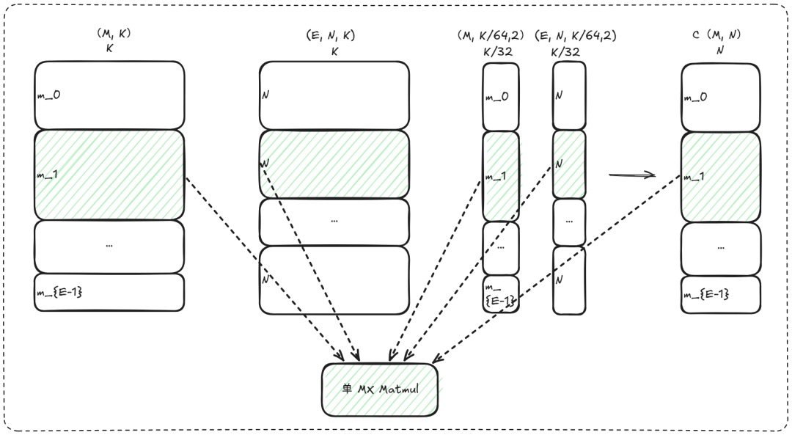

Figure 1. GMM M轴分组计算逻辑示意图

**K轴分组** 将当前组的`(M, N, K_e)`视作单个MX矩阵乘。以内积收缩维度K为划分依据，A (K, M) B (K, N)。将K维度切分为多个子通道块，各组输出大小一致，各组在对应K分片上独立计算并顺序拼接结果。

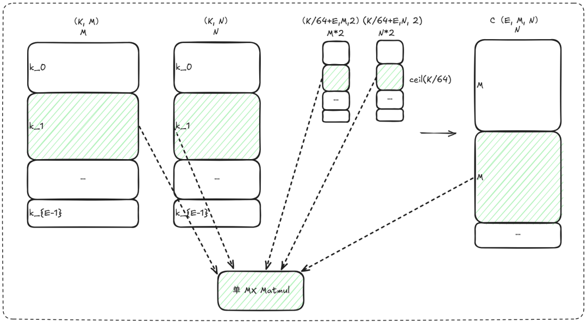

Figure 2. GMM K轴分组计算逻辑示意图

### 1.3 支持的MX量化

#### 1.3.1 MXFP4参数说明

MXFP4 旨在追求优秀的缓存利用率和性能，但其精度有限，无法支撑训练场景中的迭代需求，目前GMM MXFP4仅支持M轴分组用于推理场景。

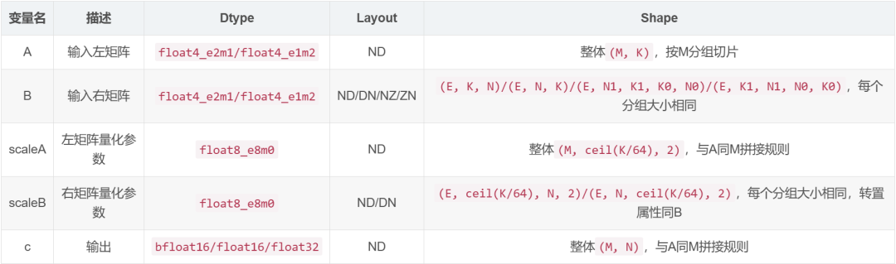

> 注：MXFP4的NZ/ZN的后两维为`(16, 64)`。

#### 1.3.2 MXFP8参数说明

为明确区分两类分组方式，以下按**M轴分组**与**K轴分组**分别给出各参数的逻辑形状与布局约束。

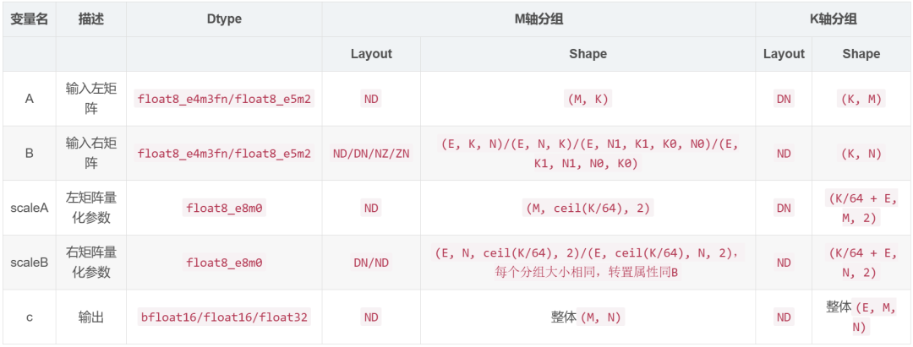

> 注：MXFP8的NZ/ZN的后两维为`(16, 32)`。

## 2 NPU实现MX量化的机制

### 2.1 硬件原理

NPU MX矩阵乘利用float8_e8m0格式仅存储指数，配合A/B矩阵存储数据尾数与局部指数，在分型矩阵乘中通过指数加法融合缩放因子，避免了显式反量化带来的值域损失。

### 2.2 指数与尾数的分离计算

在普通float8/float4的矩阵乘中，每个MMAD里PE（Processor Element）计算得到的部分和由符号、指数和尾数构成，MX矩阵乘亦是。

- 单个float数可记为

$$x = \text{sign} \times 2^{e} \times m$$

其中 $e$ 为指数，$m$ 为尾数。

- 两个低bit float数的分型乘积为

$$c_{\text{fp}} = \left( \text{sign}_A \times 2^{e_A} \times m_A \right) \cdot \left( \text{sign}_B \times 2^{e_B} \times m_B \right) = \text{sign} \times 2^{e_A+e_B} \times (m_A \cdot m_B)$$

- MX的分型乘积为

$$c_{\text{mx}} = c_{\text{fp}} \times 2^{e_{\text{scaleA}}} \times 2^{e_{\text{scaleB}}} = \text{sign} \times 2^{e_A+e_B + e_{\text{scaleA}} + e_{\text{scaleB}}} \times (m_A \cdot m_B)$$

因此，MX矩阵乘可由NPU AICore实现，一个分型（fp8：16\*16\*32，fp4：16\*16\*64）乘加一次仅一Cycle，MX矩阵乘与普通同低bit矩阵乘的算力相同。

## 3 GMM MX核心优化实践

本样例实现了完整的优化策略体系（详见cann-samples GMM mx量化性能优化文档），以下重点介绍GMM最具代表性的几种。

### 3.1 负载均衡的3种实现

- 核负载均衡率的计算公式

$$\text{核负载均衡率} = \frac{\text{平均负载}}{\text{最大负载}} \times 100\%$$

此处负载仅为M/K/N维度的计算量，平均负载是理想的核完全均匀计算的指标。算子性能的提升与负载均衡率呈正相关，但二者未必保持等比例关系。

- MEM bound，算子性能提升率一般小于核负载均衡率的提升；

- CUBE bound，算子性能提升率约等于核负载均衡率的提升。

#### 3.1.1 group间负载均衡

GMM每个分组Matmul使用基本块`(baseM, baseN)`策略进行多核分配，很大可能单分组Matmul的block块数并不能被开启的核数整除。为了高效使用每一个核，下一个分组Matmul接着上一个分组Matmul结束的核数往下分配核，避免每个分组Matmul均从0核开始计算。

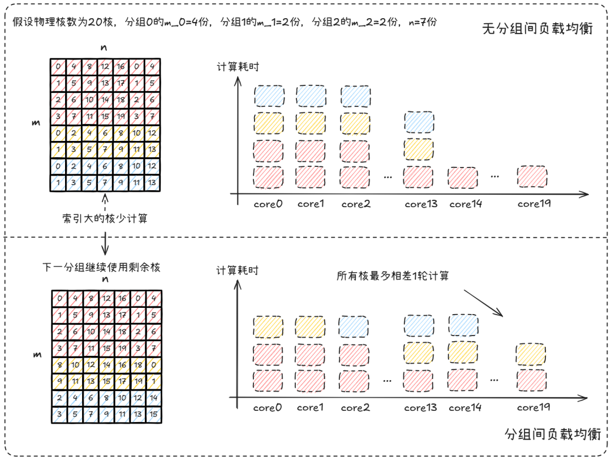

Figure 3. group间核负载均衡原理图：连续使用核

上图的平均负载为 2.8（56 blocks / 20 cores），优化前后的最大负载分别为 4和3，则核负载均衡率从70%提升至93.33%。

#### 3.1.2 M轴分组M负载均衡

M轴分组时每分组`M_e`在host侧未知，若每个分组按照基本块`(baseM, baseN)`分核，有可能一些核M轴计算量为baseM，其它核M轴计算量远小于baseM时，算子的整体性能将由最晚完成计算的核所决定，这种现象即为“快慢核”所引发的性能劣化问题。

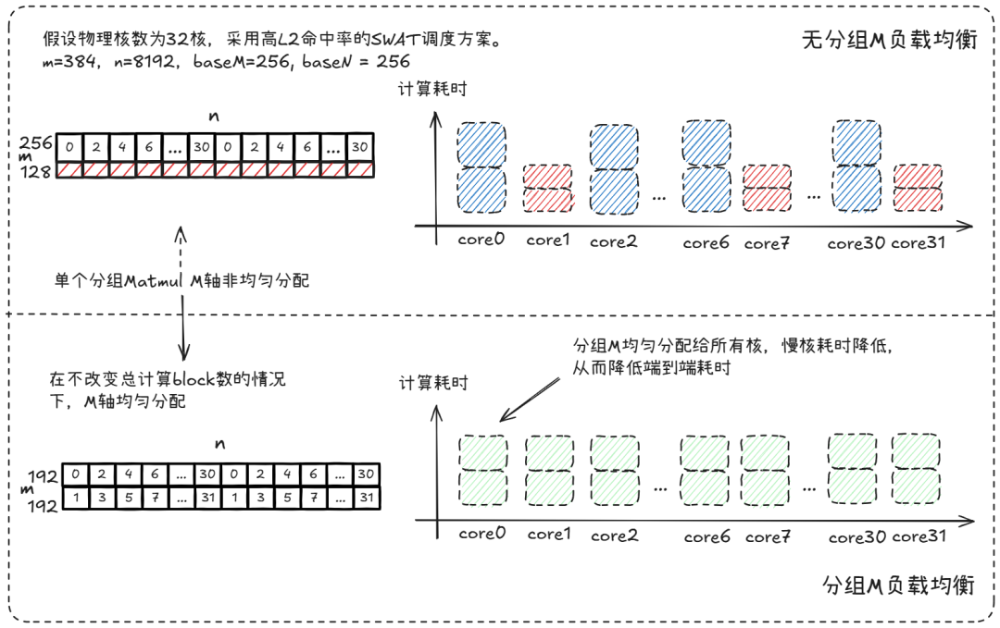

Figure 4. M轴分组M负载均衡原理图：动态调整每个分组的M计算量

上图为1个专家的M负载均衡原理图，在32核上刚好跑2轮。优化前，偶数核2轮M轴计算量均为256，奇数核2轮M轴计算量均为128，核负载均衡率为75%。使能分组M负载均衡后，奇偶核的M轴计算量均为192，核负载均衡率为100%。

> 当前实验环境为Ascend950PR, GM带宽1.6T/s，32核。

E=2，M轴分组，K=2048，N=8192，分组值分别为384，800和1900，baseN=256，baseM从256分别均衡到192，208和240。

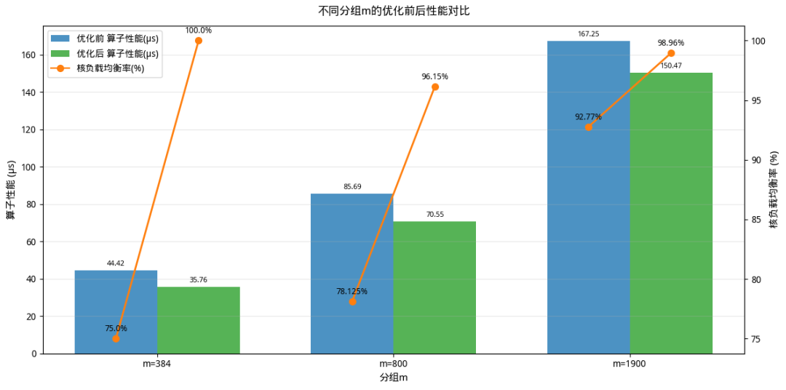

Figure 5. 不同分组M值（固定E=2, K=2048，N=8192）的核负载均衡率和算子性能

#### 3.1.3 最后一个group尾轮负载均衡

在处理不同规格输入时，划分的基本块无法均匀分配到所有核上，导致分核不均。需要针对最后一轮基本块进行二次切分（支持切分M和N轴），使其尽量均匀分配到多核中，充分发挥完整算力。

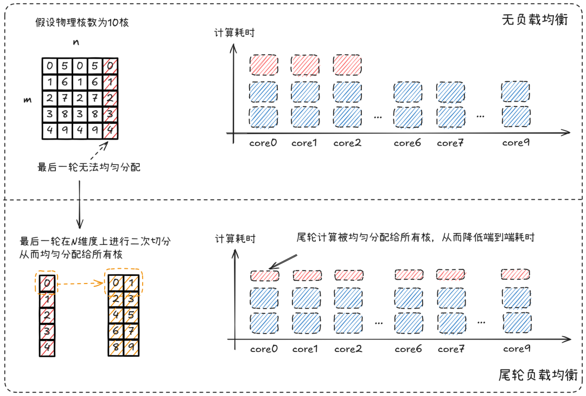

Figure 6. 最后一个group尾轮负载均衡原理图：对最后一轮基本块进行二次切分（支持切分M和N轴）

> 当前实验环境为Ascend950PR, GM带宽1.6T/s，32核。

E=2，M轴分组，group_list={256,256}，M=1024，K=2048，N=5120

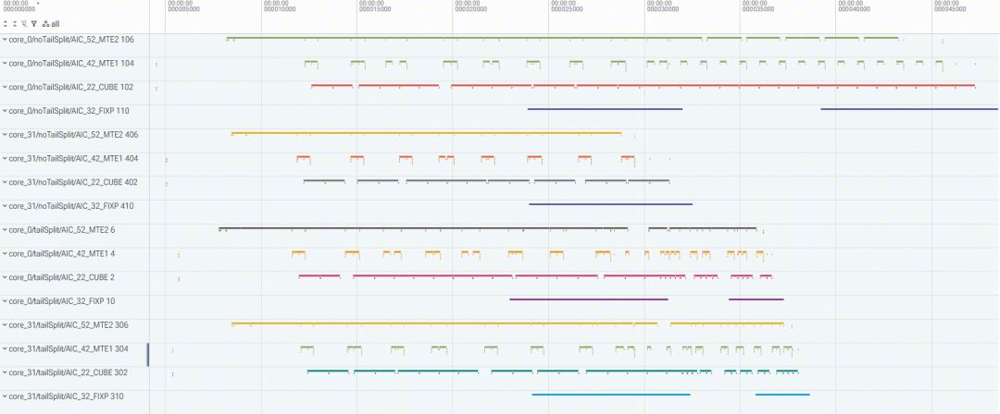

Figure 7. 最后一个group尾轮负载均衡核0和核31流水图对比：上为无尾轮负载均衡，下为有尾轮负载均衡

启用尾轮负载均衡前，最大负载的核0需计算2个（256, 256）基本块，尾轮仅8个核计算，核负载均衡率仅为 62.5%。优化后，所有核均需计算1个（256, 256）基本块和尾轮的1个（128, 128）基本块，核负载均衡率可到100%。

### 3.2 scalar优化

GMM的kernel主流程为：

```cpp
void Run(const Params& params) {
    // 初始化
    Init(params);

    // 创建调度器
    using SchedulerOp = BlockScheduler;
    SchedulerOp bs(params.schedulerParams);

    // 遍历所有分组
    for (uint32_t groupIdx = 0; groupIdx < groupNum_; ++groupIdx) {
        // 更新当前分组偏移
        UpdateOffset(groupIdx);

        // 设置当前分组的 M, N, K
        SetMNK(groupIdx);

        // 获取问题形状中的 M 和 K
        auto M = get<MNK_M>(problemShape_);
        auto K = get<MNK_K>(problemShape_);

        // 若 M 或 K 非正，跳过该分组
        if (M <= 0 || K <= 0) {
            continue;
        }

        // 更新 MMAD 运算单元shape参数
        mmadOp_.UpdateParamsForNextProblem(problemShape_);

        // M轴分组的M负载均衡
        BaseMBalance(bs, M, params.kernelParams.baseM);

        // 构造调度器问题形状 (M, N, K, 1)
        typename SchedulerOp::TupleShape bsProblemShape = {M, N, K, 1L};

        // 更新调度器的下一个问题
        bs.UpdateNextProblem(bsProblemShape);

        // 判断是否为最后一个分组且需要拆分
        if (IsLastGroupAndNeedSplit(bs, groupIdx)) {
            bs.UpdateTailTile();  // 使能尾轮切分
            ProcessSingleGroup(params, bs, false);   // false: 尾部处理，包含该分组的tensor构造
        } else {
            ProcessSingleGroup(params, bs, true);    // true: 正常处理，包含该分组的tensor构造
        }
    }
}
```

从主流程Run函数可以看出，除了ProcessSingleGroup里带有分组矩阵乘计算，其它均为scalar。GMM scalar优化项：

- 并不是每个核需要计算每个专家，信息非必要不更新，如分组偏移，MMAD shape更新，该分组的tensor构造

- 每个循环内减少判断是否是最后一个group，分主尾group

- 减少重复计算，如分组偏移里M轴分组B偏移

- 尽可能使用位运算

- 减少if scalar判断，尽可能使用常量判断

- 避免新建不必要变量

主流程优化后：

```cpp
void Run(const Params& params) {
    Init(params);

    // 创建调度器
    using SchedulerOp = BlockScheduler;
    SchedulerOp bs(params.schedulerParams);

    // 处理前 groupNum_ - 1 个分组
    for (uint32_t groupIdx = 0; groupIdx < groupNum_ - 1; ++groupIdx) {
        SetMNK(groupIdx);
        auto M = get<MNK_M>(problemShape_);
        auto K = get<MNK_K>(problemShape_);
        if (M <= 0 || K <= 0) {
            continue;
        }
        BaseMBalance(bs, M, params.kernelParams.baseM);
        bs.UpdateNextProblem(problemShape_);
        ProcessSingleGroup<false>(params, bs, groupIdx);   // 普通处理
    }

    // 处理最后一个分组（groupNum_ > 0）
    uint32_t groupIdx = groupNum_ - 1;
    SetMNK(groupIdx);
    auto M = get<MNK_M>(problemShape_);
    auto K = get<MNK_K>(problemShape_);
    if (M > 0 && K > 0) {
        BaseMBalance(bs, M, params.kernelParams.baseM);
        bs.UpdateNextProblem(problemShape_);
        if (IfNeedSplit(bs)) {
            bs.UpdateTailTile(); // 使能尾轮切分
            ProcessSingleGroup<true>(params, bs, groupIdx);   // 尾部拆分处理，包含该分组的tensor构造
        } else {
            ProcessSingleGroup<false>(params, bs, groupIdx);  // 普通处理，包含该分组的tensor构造
        }
    }
}
```

> 当前实验环境为Ascend950PR, GM带宽1.6T/s，32核。

E=128，M轴分组，分组M值均为256，M=32768，K=2048，N=96

| | dur(us) | mac_t | mac_r | scalar_t | scalar_r | mte1_t | mte1_r | mte2_t | mte2_r | fixp_t | fixp_r |
| --- | --- | --- | --- | --- | --- | --- | --- | --- | --- | --- | --- |
| scalar优化前 | **67.608** | 17.258 | 0.258 | **20.172** | 0.302 | 10.012 | 0.15 | 56.556 | 0.846 | 13.32 | 0.199 |
| scalar优化后 | **65.297** | 16.929 | 0.262 | **15.772** | 0.244 | 9.8 | 0.152 | 57.389 | 0.889 | 12.623 | 0.195 |

本用例baseM=256，baseN=96，每个核每隔32个专家计算一个专家（仅一个block块），scalar耗时从20.17us降至15.77us（优化4.4us，21.8%），scalar占比从30.2%降至24.4%。而算子耗时仅从67.608us降至65.297us，scalar优化对算子性能提升程度要视scalar是否阻塞流水或scalar bound而定，而scalar优化是必做的。

### 3.3 高搬运带宽的私有数据排布

数据和 scale 均可从 GM 中直接以私有格式（可统称为 `NZ`）加载至 L1，从而提升 MTE2 的搬运带宽。

#### 3.3.1 weight NZ

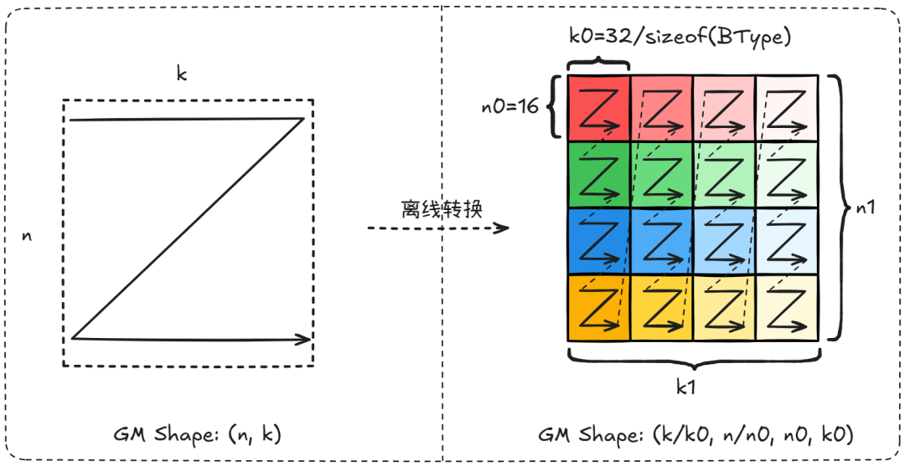

Figure 8. 数据B离线转私有格式原理图：私有格式的数据排布转换过程

> 当前实验环境为Ascend950PR和Ascend950DT, GM带宽1.6T/s和4T/s，32核。

E=6，group_list={1,1,1,1,1,1}，M=32，K=1536，N=24576，**mem bound，收益场景**

| 芯片 | 全ND耗时(us) | B NZ耗时(us) | 性能优化率 |
| --- | --- | --- | --- |
| 950PR | 149.707 | 148.984 | 0.48% |
| 950DT | 83.688 | 75.669 | 9.58% |

#### 3.3.2 scaleB NZ

由于 scale 的 K 维与数据的 K 维存在 group size = 32 倍的关系，scale 的 K 轴通常较小，甚至不满足256B对齐，因而导致带有格式转换的指令的带宽利用率低于数据搬运。

进一步地，scale 数据从 L1 搬运至 L0A_MX 或 L0B_MX 时不具备转置（transpose）功能。因此，GM 中 scaleB 的私有格式应与 L1 及 L0B_MX 上的存储格式保持一致，即 `(n1, ceil(k/64), n0, 2)`，其中 `n0=16`, `n1=ceil(n/n0)`。

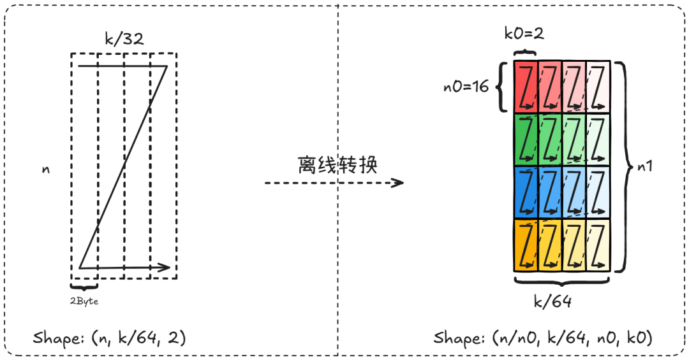

Figure 9. scaleB离线转私有格式原理图：私有格式的数据排布转换过程

> 当前实验环境为Ascend950PR和Ascend950DT, GM带宽1.6T/s和4T/s，32核。

E=6，group_list={1,1,1,1,1,1}，M=32，K=1536，N=24576，**mem bound，收益场景**

| 芯片 | 全ND耗时(us) | scaleB NZ耗时(us) | 性能优化率 |
| --- | --- | --- | --- |
| 950PR | 149.707 | 149.54 | 0.11% |
| 950DT | 83.688 | 82.951 | 0.88% |

### 3.4 双页表

默认情况下，GM数据经L2缓存进入L1，但因weight数据量大，其加载过程会迫使L2中的有效数据回写至GM，产生额外MTE2开销。如果在小m（<=baseM）场景下，weight数据仅使用一次，若将其从GM直接加载至L1，不仅不会增加原有加载耗时，还可避免非必要的L2有效数据回写。

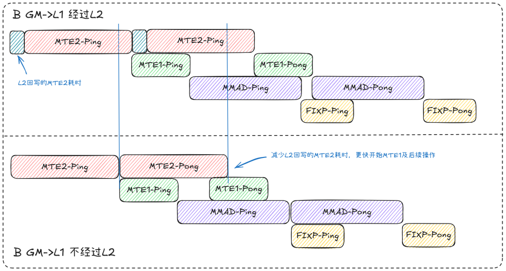

Figure 10. 双页表流水原理图：通过控制不进入L2，减少L2回写提升MTE2性能

> 当前实验环境为Ascend950PR, GM带宽1.6T/s，32核。

E=48，M轴分组，group_list={256,256,...,256}，M=12288，K=2048，N=5120 输入A 24MB，输入B 480MB，输出120MB，baseM=256，baseN=256，每份专家从GM加载只使用一次，如果将输入B加载进L2，输出极大概率回写到L2。

> 注：在单算子性能测试中，L2 缓存初始为空，小规模算例的 weight 数据即便加载至 L2，整体数据量也不会超过 L2 容量，因此性能表现保持稳定。而在整网环境下，L2 缓存中已存在脏数据区域，此时即使算子的输入输出总和未超出 L2 容量，也大概率会因 L2 数据回写至 GM 而导致 MTE2 性能劣化。

| | dur(us) | mac_t | mac_r | scalar_t | scalar_r | mte1_t | mte1_r | mte2_t | mte2_r | fixp_t | fixp_r |
| --- | --- | --- | --- | --- | --- | --- | --- | --- | --- | --- | --- |
| 无双页表 | 458.426 | 314.602 | 0.687 | 53.674 | 0.117 | 105.023 | 0.229 | **451.33** | 0.986 | 176.431 | 0.385 |
| 有双页表 | 427.128 | 313.737 | 0.736 | 53.958 | 0.127 | 105.515 | 0.247 | **420.085** | 0.985 | 169.479 | 0.398 |

### 3.5 2-Buffer VS 3-Buffer

Double Buffer使用两个缓冲区交替工作：一个缓冲区用于当前计算，另一个并行准备下一轮数据。通过计算与数据加载/准备的重叠，隐藏内存访问延迟，减少流水线停顿，提高算子吞吐量。

- **Double Buffer（2-Buffer） vs 3-Buffer**

  - `A1 + B1 + scaleA + scaleB + A3 <= HALF_L1_SIZE`

  - `A2 + B2 + scaleA + scaleB + B3 <= HALF_L1_SIZE`

    其中，A1=A2=A3,B1=B2=B3，A1/B1分别为A/B一次MTE2搬运到L1的数据量。注意3-Buffer中第三份缓冲会引起L1 bank conflict，在Mem bound时有收益。打满带宽的一条MTE2的数据量需为64KB，MX需要将A/B/scaleA和scaleB搬进L1，原始data和scale矩阵的数据量约为32:1，且host无法获取group_list里具体的值，因此一般按照A矩阵的原始矩阵的M来计算baseM，GMM MX最多支持3-Buffer。

- **2-Buffer**：两份buffer交替，覆盖“当前计算/下一轮准备”的基本重叠关系，资源开销更小。

- **3-Buffer**：相较2-Buffer，3-Buffer仅在L1侧增加第三份阶段缓冲（A/B数据），L0层级仍为2-Buffer，以减少因搬运抖动、带宽瞬时不足造成的断流风险。

- **使能3-Buffer条件**：需满足L1容量约束，在保持`baseM/baseN/baseK`块大小后不引入新的瓶颈。当前GMM MX 3-Buffer需要满足上述L1容量约束条件。

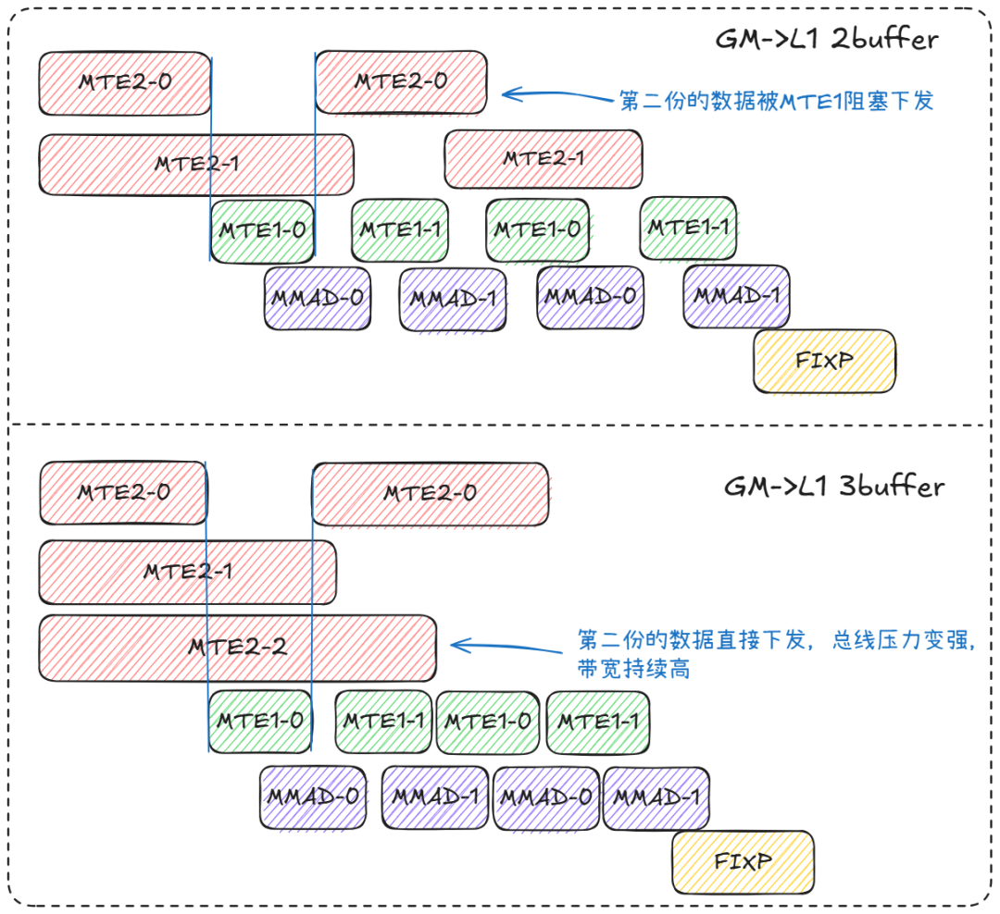

Figure 11. N-Buffer流水原理图：通过下发更多MTE2请求提升带宽

> 当前实验环境为Ascend950DT, GM带宽4T/s，32核。

以下均为MXFP8 ND场景的在不同shape下的实验结果：

- E=6，group_list={1,1,1,1,1,1}，M=32，K=3584，N=2560，**MEM bound，收益场景**

| | dur(us) | mac_t | mac_r | scalar_t | scalar_r | mte1_t | mte1_r | mte2_t | mte2_r | fixp_t | fixp_r |
| --- | --- | --- | --- | --- | --- | --- | --- | --- | --- | --- | --- |
| 2Buffer | 22.654 | 5.314 | 0.239 | 6.689 | 0.301 | 6.923 | 0.311 | 19.255 | 0.866 | 3.55 | 0.16 |
| 3Buffer | 21.746 | 5.354 | 0.251 | 7.379 | 0.346 | 7.518 | 0.352 | 17.964 | 0.841 | 3.117 | 0.146 |

- E=3，group_list={10,10,10}，M=2048，K=2048，N=5120，**MEM bound，收益场景**

| | dur(us) | mac_t | mac_r | scalar_t | scalar_r | mte1_t | mte1_r | mte2_t | mte2_r | fixp_t | fixp_r |
| --- | --- | --- | --- | --- | --- | --- | --- | --- | --- | --- | --- |
| 2Buffer | 12.796 | 3.1 | 0.247 | 4.47 | 0.356 | 4.003 | 0.319 | **10.572** | 0.842 | 3.628 | 0.23 |
| 3Buffer | 12.371 | 3.177 | 0.262 | 4.691 | 0.386 | 4.441 | 0.366 | **10.15** | 0.836 | 3.26 | 0.26 |

- E=2，group_list={2048,2048}，M=4096，K=2048，N=5120，**CUBE bound，非收益场景**

使能3-Buffer性能整体无收益，MTE2有预期收益，但是MTE1因为3-Buffer增加的L1 Bank Conflict而劣化。

| | dur(us) | mac_t | mac_r | scalar_t | scalar_r | mte1_t | mte1_r | mte2_t | mte2_r | fixp_t | fixp_r |
| --- | --- | --- | --- | --- | --- | --- | --- | --- | --- | --- | --- |
| 2Buffer | 106.745 | 101.48 | 0.956 | 19.934 | 0.188 | 34.753 | 0.327 | 91.753 | 0.864 | 55.291 | 0.521 |
| 3Buffer | 106.98 | 101.466 | 0.952 | 20.373 | 0.191 | 37.513 | 0.352 | 89.596 | 0.84 | 56.141 | 0.527 |

- E=8，group_list={4096,4096,4096,4096,4096,4096,4096,4096}，M=32768，K=4096，N=7168，**CUBE bound，非收益场景**

超大shape时，因3-Buffer多增加的scalar和L1 bank conflict导致scalar和MTE1明显增加，而劣化的单流水在Ascend950上能被CUBE计算掩盖，算子性能持平。

| | dur(us) | mac_t | mac_r | scalar_t | scalar_r | mte1_t | mte1_r | mte2_t | mte2_r | fixp_t | fixp_r |
| --- | --- | --- | --- | --- | --- | --- | --- | --- | --- | --- | --- |
| 2Buffer | 2245.45 | 2238.978 | 0.997 | 377.817 | 0.168 | 776.054 | 0.346 | 1788.711 | 0.797 | 618.712 | 0.276 |
| 3Buffer | 2245.647 | 2239.781 | 0.998 | 401.602 | 0.179 | 826.549 | 0.368 | 1789.974 | 0.797 | 621.594 | 0.277 |

## 4 总结

本文在阐述GMM算子计算逻辑与NPU MX矩阵乘实现原理的基础上，系统梳理了GMM核心的性能优化实践并进行了相应分析。算子开发优秀实践建议：

- scalar优化：非必要不更新，精简计算与判断，复用偏移，常量优先

- 负载均衡：核不空闲，每核计算量尽可能均衡

- 提升搬运效率：高L2命中率，私有格式搬运，避免不必要的L2回写，搬运指令猛发

## 5 附录

### 5.1 几组MXFP8典型KN的MBU和MFU

E=6，全ND，M轴分组，group_list = {m,m,...}，M = E \* m，{K, N}={2048, 7168}，{7168, 2048}，{4096, 3072}，{1536, 4096}，{4096, 4096}，{4096, 7168}，{7168,4096}。

> 当前实验环境为Ascend950PR, GM带宽1.6T/s，32核。

#### 5.1.1 MBU：Memory Bandwidth Utilization（内存带宽利用率）

MBU意在获取算子的GM带宽利用率，并且假定GM读写数据量大小为输入和输出之和。在MX场景下，还需额外考虑两个缩放因子（scale）的输入数据量。

- 普通MBU公式：

$$\text{mbu} = \frac{(M \times K) \times \text{sizeof}_A + (E \times N \times K) \times \text{sizeof}_B + (M \times N) \times \text{sizeof}_C }{\text{duration} \times BW_{GM}}$$

- MX MBU公式：

$$\text{mbu} = \frac{(M \times K) \times \text{sizeof}_A + (E \times N \times K) \times \text{sizeof}_B + (M + N) \times K / 32 + (M \times N) \times \text{sizeof}_C}{\text{duration} \times BW_{GM}}$$

其中，$\text{duration}$ 是算子耗时（单位：us），分子为输入输出的大小（单位：B），GM带宽 $BW_{GM} = 1.6 \times 10^6$。

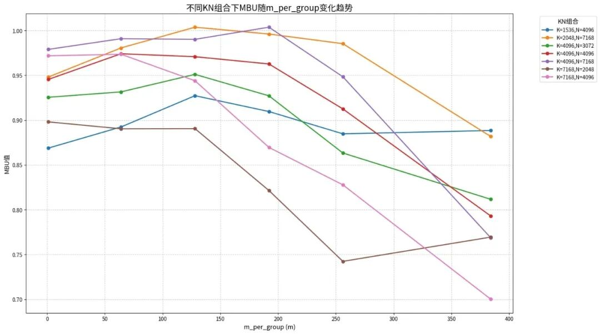

Figure 12. MBU图：固定E/K/M的均衡M值{1,64,128,192,256,384}的MBU折线图

在算子实际实现中，输出 L2 缓存的相关参数并未被显式控制。若输出数据能够完全容纳于L2缓存中，则无需再从L2写回GM。上图两个异常现象的解释：

- 当 K=7168、N=2048 时，m=384 对应的 MBU 优于 m=256。原因在于单算子测试中，两种情形下的输出数据均未超出 L2 容量（即无需写回 GM），且 m=384 时 B 矩阵的L2命中率更高，因此算子耗时与 m 不呈线性增长。

- MBU值超过1，是由于在单算子测试中输出数据存放于L2缓存内，且L2带宽（5.2 T/s）远高于当前实验环境中的 GM 带宽（1.6 T/s）。

因此，若希望评估MBU，建议采用`m=1`的配置，此时可基本消除L2对输入与输出的影响。

#### 5.1.2 MFU：Model FLOPs Utilization（模型浮点运算利用率）

MFU 是衡量芯片算力是否被有效利用的关键指标。

- MFU公式：

$$\text{mfu} = \frac{M \times K \times N \times 2}{\text{duration} \times \text{TFLOPS}}$$

其中，$\text{duration}$ 是算子耗时（单位：us），分子为理论的矩阵乘加总数，$\text{TFLOPS}$ 是理论算力值，在此实验环境上8bit矩阵乘该值为865T。

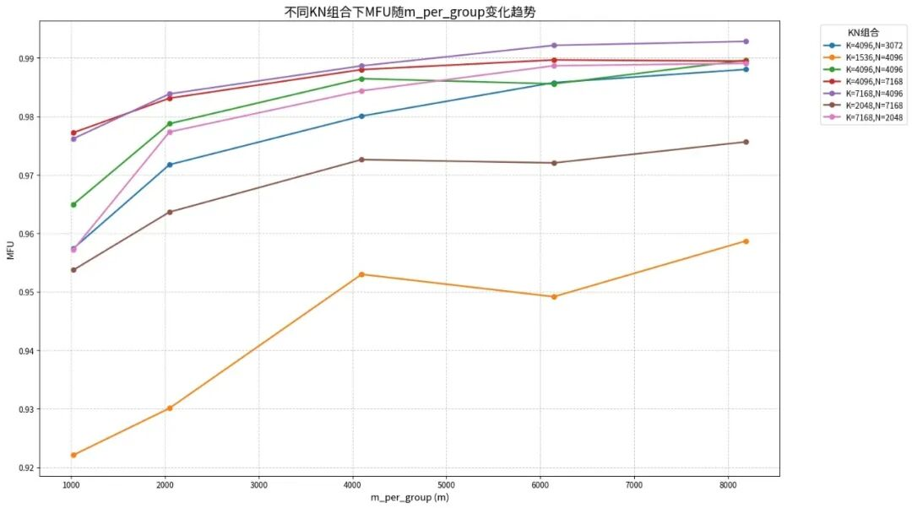

Figure 13. MFU图：固定E/K/M的均衡M值{1024,2048,4096,6144,8192}的MFU折线图

对于所有 (K, N) 组合，MFU 值随 m 增大总体呈稳定上升趋势。其中，K=7168、N=4096与K=4096、N=7168这两个大shape组合的 MFU值始终处于最高区间（最高可至 99.5%）。个别数据点因L2缓存行为的影响，MFU值出现轻微下降。

### 5.2 cann-samples相关资源

- 性能优化指南：Samples/2_Performance/grouped_matmul_story/docs/quant_grouped_matmul_mx_performance.md

- MXFP8样例代码：Samples/2_Performance/grouped_matmul_story/grouped_matmul_recipes/examples/quant_grouped_matmul_mxfp8

- MXFP4样例代码：Samples/2_Performance/grouped_matmul_story/grouped_matmul_recipes/examples/quant_grouped_matmul_mxfp4

我们希望样例能够帮助开发者快速掌握GMM MX矩阵乘的优化方法，也期待社区的反馈与建议。如有问题，欢迎在cann-samples issue提出。
