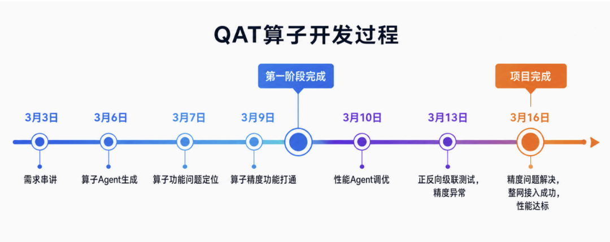
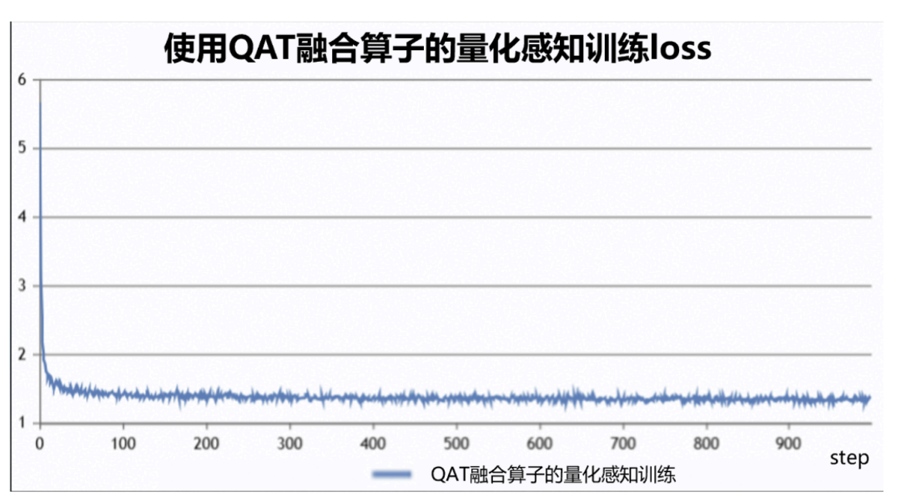
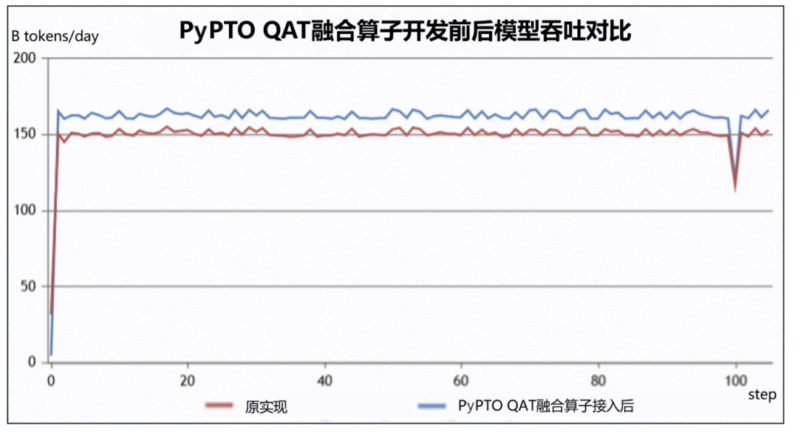
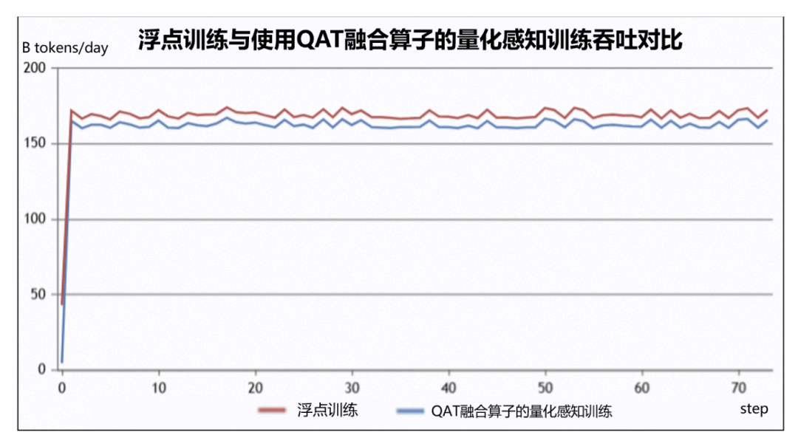

# 基于PyPTO与Agent，2周完成模型QAT算子开发与优化

## 1. 背景介绍

模型量化能够通过低比特表示降低推理阶段的存储和计算开销，但直接进行训练后量化（Post-Training Quantization，PTQ）时，模型往往会因量化误差而出现精度下降，尤其是低比特量化场景下，这一问题更加明显。为缓解量化带来的精度损失，量化感知训练（Quantization-Aware Training，QAT）在训练过程中模拟部署时的量化行为，使模型逐步适应低精度表示带来的数值扰动，从而在获得量化部署收益的同时，尽可能保持模型精度。

大模型的量化感知训练需要配套高效的 QAT 算子，覆盖对称 per-tensor、对称 per-channel、非对称 per-group 等形态，对应 Embedding、Lm Head、Transformer Linear 等典型网络层场景，还要完成前向和反向的双重实现，开发和优化难度较大，通常需要较长的开发周期。基于 PyPTO 简单易用的开发方式 结合 Agent 辅助编程，2周便完成了 QAT 算子的功能实现、性能优化和模型接入，从零开始迅速完成算子的开发应用。



## 2. QAT 功能开发：首周完成功能打通和整网接入测试

PyPTO 的算子写法接近普通张量计算。以前向对称量化为例，核心计算可以概括为三步：先对 scale 做防零保护，再对 weight 归一化、取整并截断，最后乘回 scale 得到伪量化输出。

$$s' = \max(s, \varepsilon)$$

$$q = \operatorname{clip}(\operatorname{round}(W / s'), min\_v, max\_v)$$

$$Y = q \times s'$$

在 qat_impl.py 中，这组公式可以直接落成一组语义明确的张量 API：

```python
scale_fp32 = pypto.cast(scale_tile, pypto.DT_FP32)
protected_scale = pypto.maximum(scale_fp32, eps)
normalized = pypto.div(weight_fp32, protected_scale)
rounded = pypto.round(normalized, decimals=0)
clamped = pypto.clip(rounded, min_v, max_v)
output = pypto.mul(clamped, protected_scale)
output_tile = pypto.cast(output, pypto.DT_BF16)
pypto.assemble(output_tile, [n_offset, 0], output_bf16)
```

其中，maximum 对应 scale 防零保护，div 对应归一化，round 对应量化取整，clip 对应量化范围约束，mul 对应乘回 scale。这样的写法降低了开发者的理解和实现难度，也降低了 AI 参与开发的难度。AI 可以围绕“公式到张量 API”的映射生成代码、检查 shape/dtype、定位局部修改点，减少从底层搬运、指令调度和复杂模板中反推算法意图的成本。

PyPTO Skills便在此基础上提供了自动化的算子开发能力，将功能开发拆分成 设计 -> 实现 -> 验证 -> 接入 四个阶段，每个阶段对应一个skill:

- pypto-op-design：把公式拆成 API 映射、精度路由、tiling 推导和 loop 结构，让 Agent 先形成可落地的设计文档。

- pypto-op-develop：基于设计文档生成 PyPTO kernel，把公式和 shape/dtype 约束转成具体实现。

- pypto-op-verify：用 golden 和 detailed_tensor_compare 验证输出正确性，避免只完成代码生成而缺少功能闭环。

- pypto-fused-op-integration：在算子功能完成后推进模型侧集成，连接 kernel 实现和整网调用。

基于PyPTO Skills，首周便完成了QAT算子的功能开发和整网接入测试。

## 3. QAT性能调优：围绕PyPTO三大关键调优能力一周完成性能优化

PyPTO中功能开发和性能调优相对独立，通过四个独立的关键参数控制三大算子优化方向，不干扰具体的功能实现：

- pypto.frontend.jit 提供编译和执行层面的调优旋钮，例如 vec_nbuffer_setting、stitch_function_max_num 等。

- loop 和 unroll_list 用于处理动态轴，并控制循环内部并发度。

- tile_shape 决定 kernel 侧的数据切分方式，影响片上缓存、向量计算和归约效率。

这三类能力共同构成了 PyPTO 的参数化调优路径。确定优化方向后，很多优化动作可以通过调整 unroll_list、set_vec_tile_shapes 或 JIT 参数完成，然后快速压测验证。

### 3.1 pypto.frontend.jit 调优：通过编译旋钮合并无依赖子图

第一类优化来自 pypto.frontend.jit。在 QAT 实现中，kernel 外层通过 JIT 装饰器声明运行时和 pass 选项，例如：

```python
@pypto.frontend.jit(
    runtime_options={
        "stitch_function_max_num": 64,
    },
    pass_options={"vec_nbuffer_setting": {-1: 4}},
)
```

这些参数提供了编译期和执行期的调优入口。QAT 计算中存在多个相对独立的子图，例如归一化、取整、截断、类型转换和写回等。部分子图之间没有强依赖关系，适合通过 JIT 参数调整，让编译器更合理地合并子图，增强单次计算规模来更充分地填充硬件流水。

本次调优主要针对 vec_nbuffer_setting 参数。对于无依赖或弱依赖子图，合适的 nbuffer 设置可以改善流水和 buffer 使用，让多个计算片段更自然地组合在一起。调优动作仍然保持参数化：计算逻辑保持稳定，主要修改 JIT pass 参数，然后通过 profiling 观察调整后的流水并行效果，此阶段优化完 QAT 中的非对称正向算子耗时从 286.76us 降低到 258.8us，性能提升 10.8%。

### 3.2 unroll_list 调优：提升并发度，同时控制编译和显存开销

QAT 算子需要处理动态 shape。PyPTO 中通过 pypto.loop_unroll 遍历动态轴，再用 unroll_list 控制循环展开粒度。例如 per-tensor 和 per-channel 相关实现中可以看到如下结构：

```python
unroll_list = [512, 32, 8]
for n_offset, unroll_length in pypto.loop_unroll(
    0, n, 1,
    name="LOOP_N_UNROLL",
    idx_name="n_offset",
    unroll_list=unroll_list
):
    tile_n = unroll_length
```

性能调优初期，unroll_list 参数设置较小，循环内部一次处理的数据量有限，kernel 内部并发度不足，算力利用率偏低。调大 unroll 参数后，单次循环可以覆盖更大的数据块，计算并行度提升，性能也随之改善。

但 unroll 需要在性能收益和资源开销之间取平衡。参数过大会增加单个分支中的显存占用，过多挡位也会增加编译开销。如果所有可能 shape 都展开成大量分支，虽然覆盖面更广，但会消耗很多额外的资源。

因此最终策略是结合不同参数规模模型中真实出现的算子 shape 规格进行收敛。由于不同参数规模模型中的 QAT 算子 shape 相对固定，我们针对这些固定的 shape 设置对应的 unroll 分支，让常见规格获得较高并发度，同时避免无意义的挡位膨胀，最终在没有引入过多额外开销的同时，QAT 中对称正向算子性能从1809.32us 优化到 1518.18us，提升19.1%。

### 3.3 tile_shape 调优：让切分贴近数据类型、缓存和归约特征

第三类优化来自 tile shape。PyPTO 通过 pypto.set_vec_tile_shapes 控制 kernel 侧切分。例如代码会根据尾轴长度设置 tile：

```python
tile_shapes_m = min(m, 4096)
pypto.set_vec_tile_shapes(4, tile_shapes_m)
```

在归约阶段，做法可以抽象为切换到更适合归约的 tile 设置：

```python
pypto.set_vec_tile_shapes(512, 1)
reduced_tile_a = pypto.sum(tile_a, dim=0, keepdim=True)
reduced_tile_b = pypto.sum(tile_b, dim=0, keepdim=True)
```

tile shape 的第一原则是尽可能大。较大的 tile 可以提高单次 kernel 处理的数据量，减少调度开销，也更容易提高向量计算效率。但 tile 大小需要受片上资源约束，不能只看元素个数，还要结合实际数据类型计算占用。例如 BF16、FP32 在同样 shape 下占用不同，调优时通常将 tile 块控制在64KB及以下。

对于归约类子图，还需要避免盲目切归约轴。切分归约轴可能引入额外的中间结果和二次合并，反而降低效率。因此调优时优先把 tile shape 分配给尾轴，让连续数据访问更友好；归约发生时，再切换为适合归约输出形态的 tile 设置。

QAT中的非对称反向算子在此阶段优化后耗时从 455.78us 降低到 367.58us，性能提升 23.9%。

### 3.4 PyPTO Skills性能调优

以上三类优化也被 pypto-op-perf-tune skill 组织成了完整的调优闭环。这个 skill 将性能调优拆成可执行、可验证、可回退的流程：

- 精度和环境门控：调优前先确认 NPU 环境可用，并保证算子精度校验通过。这样可以避免把功能错误误判为性能问题，也避免调优过程中引入精度回退。

- 性能数据采集：通过 debug options 采集性能数据，生成 swimlane 数据和气泡分析信息，为后续判断瓶颈提供依据。

- 性能分析建基线：基于性能报告建立 baseline，先判断瓶颈来自前端写法、任务调度、合图效果，还是单 task 内部执行。

- 分阶段调优：PHASE_FRONTEND 关注 loop 写法、unroll_list、TileShape、基础 runtime options；PHASE_SWIMLANE 结合泳道图分析核使用率、负载均衡、Stitch、合图和调度策略；PHASE_INCORE 面向单 task 瓶颈处理指令级优化、核内流水和特殊 shape。

- 单参数迭代验证：每轮只修改一个调优点，重新验证精度并采集性能，对比基准后记录收益；遇到精度失败、编译失败、超时或性能退化时及时回退。

上述的优化点通过 Agent 反复的调参验证，在两周内完成了所有场景算子前向反向的性能调优。

## 4. 算子效果展示

### 4.1 精度展示

2048卡使用QAT融合算子进行某大模型量化感知训练，loss正常收敛。



### 4.2 性能展示

1.与开发QAT融合算子前的小算子拼接实现相比，模型量化感知训练性能提升**12%**。



2.与原浮点训练相比，量化感知训练由于会引入了额外的量化与反量化操作，性能通常都会下降，使用QAT融合算子进行量化感知训练与原浮点训练相比仍保持了95%的吞吐量。



## 5. 总结

QAT 算子的开发实践验证了 PyPTO 的简单易用：用高层张量 API 表达算法逻辑，用 loop_unroll、tile_shape 和 pypto.frontend.jit 等参数完成性能调优。在此基础上，Agent 可以先围绕公式和张量关系快速完成功能实现，再根据 profiling 结果调整少量参数完成优化，2周便完成 QAT 算子的开发、调优和模型接入，实现了模型吞吐性能的显著提升。PyPTO也会针对易用性和性能持续演进，并增强 Skills 能力，让开发者实现优化算子的门槛进一步降低，欢迎大家在GITCODE社区关注PyPTO仓库获取PyPTO最新的技术动态，QAT的具体算子实现也发布在了PyPTO样例仓库，通过以下链接便可直接访问：

PyPTO仓：

https://gitcode.com/cann/pypto

PyPTO样例仓：

https://gitcode.com/cann/pypto-gym

QAT算子目录：

https://gitcode.com/cann/pypto-gym/tree/master/src/pypto_gym/ops/pypto_tensor/qat
