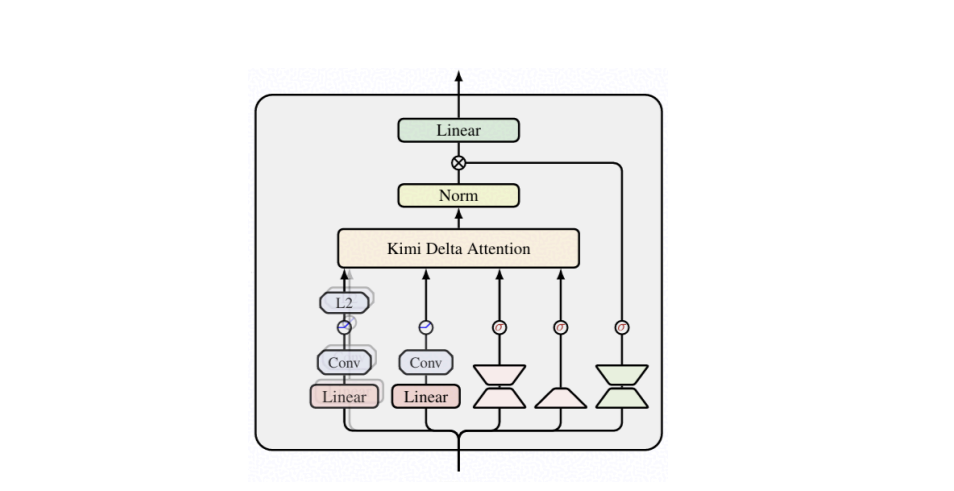
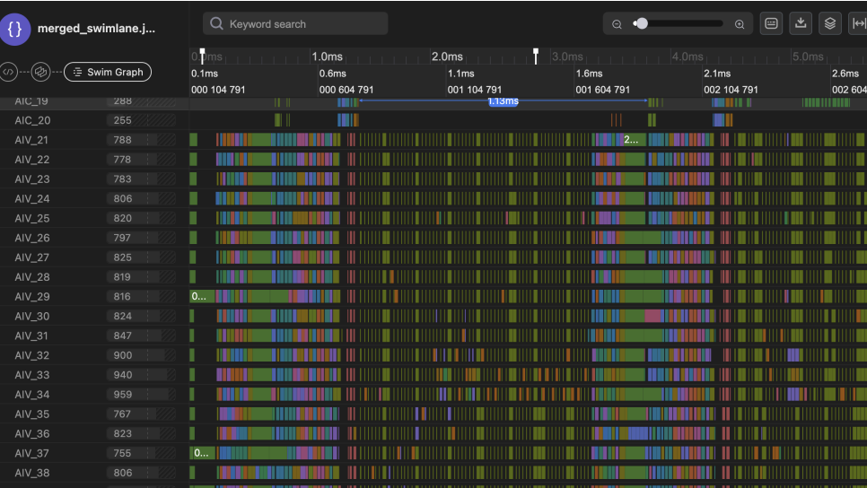
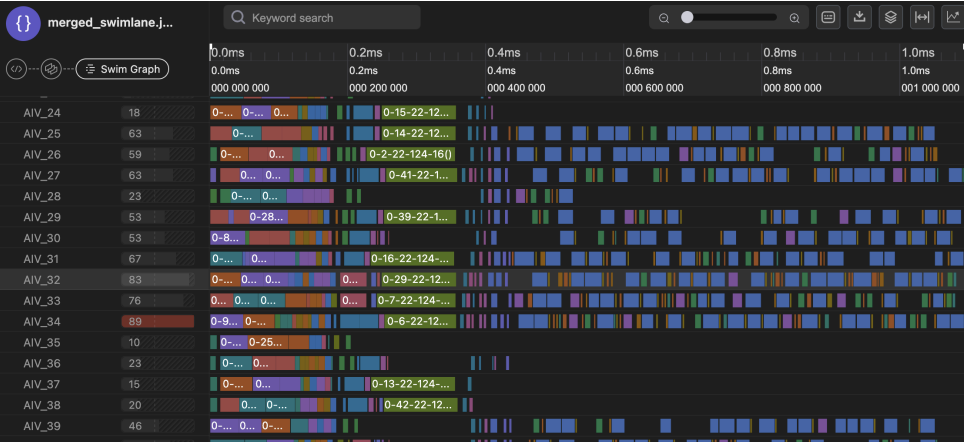

# PyPTO+CANNBot 7日交付实践：面向百灵Ling-3.0-flash的KDA算子快速实现

一周，从论文公式到上板部署。PyPTO 的 Tensor API 编程范式与 CANNBot Agent 的自动生成、调优能力，让 KDA 这种"求逆 + 递推 + 逐通道门控"的复杂融合算子开发，从手工试错走向系统化、自动化。

## 1. 背景：PyPTO 开发百灵 Ling-3.0-flash 核心算子 KDA

百灵 Ling-3.0-flash 采用原生混合线性注意力架构，以 5:1 比例交替堆叠 KDA 线性注意力层与 MLA 层。其中 KDA（Kimi Delta Attention）是模型的核心结构——它在 Delta Rule 的状态更新中引入细粒度对角门控，赋予不同特征通道独立的保留、衰减与写入控制能力，将注意力复杂度从 $O(L^2)$ 压到 $O(L)$，同时保留块内精度。

根据 Kimi Linear 论文，KDA 的核心递推公式为：

$$S_t = (I - \beta_t k_t k_t^\top)\, \text{Diag}(\alpha_t)\, S_{t-1} + \beta_t k_t v_t^\top, \quad o_t = S_t^\top q_t$$



其中 $\text{Diag}(\alpha_t)$ 是逐通道（per-channel）对角衰减门控，$\beta_t$ 是 delta 更新权重，$S_t \in \mathbb{R}^{d_k \times d_v}$ 是固定大小的状态矩阵。这一设计让每个特征维度拥有独立的遗忘率，表达能力远强于标量衰减。

然而，KDA 算子融合了矩阵乘、逐通道门控衰减、分块前向代入求逆、串行状态递推等多段复杂计算逻辑，对核内数据复用与多核并行调度要求极高。传统手写 Kernel 的开发模式难以兼顾开发效率与性能，亟需一种高效的融合算子开发范式。

PyPTO 编程框架与 CANNBot PyPTO Agent 的出现，解决了这一痛点。本次百灵 Ling-3.0-flash 昇腾适配中，Prefill 和 Decode 两个阶段的 KDA 融合算子（chunk_kda与fused_recurrent_kda）均基于 PyPTO 开发，从需求输入到精度通过、性能调优完成，仅用一周，相比原有方案，性能提升 10 倍以上。

## 2. PyPTO Tensor API + CANNBot：让复杂算子开发与调优更简单

### 2.1 PyPTO Tensor API：接近算法公式的编程范式

PyPTO 采用 PTO（Parallel Tensor/Tile Operation）编程范式，开发者描述"做什么"，框架自动完成"怎么做"。具体体现在四个层面：

- Tensor API 贴近数学表达：API 贴近公式，一行下三角矩阵乘法即可完成逐通道 cumsum。

- 自动 Tiling：框架自动切分 Tile、插入搬运指令、分配缓冲区，开发者无需管理片上缓冲地址计算。

- MPMD 高效调度：Cube 核与 Vector 核交替并行工作，由运行时调度器自动负载均衡。

- 调优手段参数化：TileShape、合图、循环展开等均有明确配置入口，配合泳道图、气泡率等可观测数据快速迭代。

这种"只描述计算意图、不感知硬件细节"的方式，对 Agent 生成代码天然友好。

### 2.2 为什么 PyPTO 对 Agent 友好

PyPTO 为 Agent 划定边界，把地址计算、同步原语等复杂动作交给框架，让 Agent 回到算法与数据流的主场。具体体现在：Agent 只需生成 Tensor 级代码，框架自动完成逐级编译降级，无需感知硬件细节；调优入口明确可参数化，Agent 围绕 Cube 分块、循环展开等配置项进行受约束搜索；过程数据驱动迭代，Agent 基于泳道图、核利用率等真实数据完成"分析→修改→验证"闭环，而非盲目试错。

### 2.3 CANNBot PyPTO Agent：27 项 Skill 构成的算子开发专家

CANNBot PyPTO Agent 采用多智能体协作，配备 27 项 Skill 覆盖算子开发全链路：

- 专家经验沉淀：调优 Skill 维护 37 个优化点索引库并按症状索引，Agent 按优先级取未尝试项而非凭直觉选题。

- 强制门禁：43 条编程规则在每阶段完成时自动触发评估，失败直接阻断进入下一阶段。

- 渐进式分模块：复杂算子自动拆分为可独立验证的模块，按递增方式逐步拼接实现。

- 上下文隔离：拆分子代理执行任务，通过共享记忆文件传递信息，避免调试日志膨胀导致质量退化。

## 3. 7 天高效完成 KDA 算子开发

KDA 算子分为chunk_kda和fused_recurrent_kda，分别对应 Prefill和 Decode两个阶段。两者计算粒度与调度方式差异明显，但开发中面临的难点是共性的：计算链路长导致一次性编码极易出错、跨块/跨 token 的串行状态递推难以拆分调试、求逆等非标准计算无原生 API。以下结合两个算子，看 PyPTO 和 Agent 如何逐一解决。

### 3.1 难点一：计算链路长，一次性编码极易出错

chunk_kda按 $C=64$ 切块，块内需完成门控前缀和、指数衰减、下三角 A 矩阵构造、8×8 分块前向代入求逆、delta 校正（w/u）、跨块状态递推等 7 段以上计算，融合范围大、数据依赖复杂。传统手写模式下，开发者通常一次性写完整个 kernel 再调试，错误定位困难。

PyPTO 的编程模板具有清晰的分层结构，分为三层：最外层是 host wrapper 层，仅做 layout 适配和输出预分配，不涉及计算逻辑；中间是 JIT kernel 入口层，由 JIT 装饰器声明，只声明纯类型签名和 runtime 配置，让多段计算融合进单个 kernel，减少内核启动开销与显存读写次数；最内层是循环层，放所有循环和计算逻辑，框架自动处理地址计算与数据搬运。三层各司其职，边界清晰。但分层规范本身不解决"拆成几段、怎么拆"的问题。

这正是 Agent 发挥作用的地方。架构设计阶段，Agent 按公式计算总复杂度，自动决策模块拆分数量。chunk_kda被拆分为 3 个模块，按递增方式逐步实现，每个模块独立编码、独立验证通过后再拼接下一个，把"一次写 800 行"拆成"三次各写 100-200 行"，一次性编码极易出错的问题得到有效缓解。

### 3.2 难点二：求逆等非标准计算无原生 API

KDA 块内需要求 $(I+A)^{-1}$，其中 A 为严格下三角矩阵。PyPTO 没有原生的矩阵求逆 API，传统模式下开发者需自行实现分块前向代入，涉及大量地址计算和搬运指令编排，极易出错。

PyPTO 的视图变换、形状重排、矩阵乘、求和、拼接等 Tensor 级原语有明确的文档约束，每个原语的输入输出 Shape、dtype、对齐要求都有清晰定义，框架自动处理片上缓冲容量、各级缓存等硬件细节。这意味着求逆不需要手写底层指令，用原语组合即可表达——但这只是让"能写"变成可能，"写得对"仍需对前向代入算法和层次合并路径有准确理解。

Agent 在这里发挥了两层作用。第一，Skill 体系中沉淀了已验证的求逆实现，Agent 不是从零开发。第二，Skill 明确了 PyPTO 原语的使用组合策略。两者叠加让 Agent 生成的 8×8 分块前向代入代码既正确又符合框架约束：

```python
def _inv_min_length(attn_dim1, eye, row_num, col_num):
    size = col_num // row_num
    cur = attn_dim1[:2, :]
    for i in range(2, row_num, 1):
        row = attn_dim1.view([1, col_num], [i, 0])
        row_exp = row.reshape([size, row_num]).view([size, i], [0, 0]) \
            .transpose(1, 0).reshape([size * i, 1])
        prod = pypto.sum((row_exp * cur.reshape([size*i, row_num])) \
            .reshape([i, col_num]), dim=0, keepdim=True)
        cur = pypto.concat([cur, row + prod], dim=0)
    return cur + eye
```

整个过程仅用视图变换、求和、拼接三种原语组合完成 8 个 8×8 求逆 → 4 个 16×16 → 2 个 32×32 → 1 个 64×64 的层次合并。PyPTO 让原语约束明确可组合，Agent 让组合过程基于专家经验而非盲目试错——两者叠加，非标准计算的实现从"高危手写"变成"可验证生成"。

### 3.3 难点三：块间依赖复杂，串行递推难以表达

chunk_kda块间以状态 $S$ 串行递推，fused_recurrent_kda更是逐 token 严格顺序递推。传统手写模式下，开发者需要手动编排同步指令、管理跨迭代的数据读写时序，一旦依赖关系表达错误，轻则性能下降，重则计算结果错误。

PyPTO 通过 Tensor 级依赖和循环级依赖两个层面解决了这个问题。在 Tensor 级，框架自动追踪数据流的读写关系，开发者只需声明数据切片的偏移量和形状，不用手写同步。在循环级，框架自动插入跨迭代的依赖约束。循环展开参数控制展开深度，为后续调优留出空间。两个层面叠加，块间依赖的表达从"手写同步指令"变成"声明依赖语义"，框架自动完成依赖分析和调度编排。

Agent 基于这两层依赖能力进行算子开发时，只需在代码中声明数据切片和标注串行边界，框架自动处理依赖追踪和调度编排，Agent 无需感知底层同步细节。

## 4. 调优参数化：Agent 自动完成性能调优

算子功能正确只是第一步，性能调优才是决定算子能否上板部署的关键。KDA 的调优面临几个典型难点：chunk 间串行依赖导致流水被阻断、子图碎片化使调度开销超过计算本身、M=1 小 matmul 无法填满 Cube、调优参数组合空间大且相互耦合。

### 4.1 难点一：chunk 间串行依赖阻断流水

chunk_kda 块间以状态 $S$ 递推，初始实现中串行边界标注被设为强制模式，每个 chunk 全量算完才进下一个，跨 chunk 流水被完全阻断。但 $S$ 递推只是整个 chunk 计算的一小部分，求逆、矩阵构造等计算本可以跨 chunk 重叠。

PyPTO 框架提供了 Tensor 级的依赖能力构建，让真正有数据依赖的部分施加串行约束，其余计算允许跨迭代重叠。循环展开参数控制展开深度，增加子图并行粒度，从而进行并行加速。

Agent 借助 PyPTO 框架的可观测能力，通过泳道图数据定位性能瓶颈，确认瓶颈在气泡率、核利用率等指标上。据此按优化库索引优化方向，调整串行约束开关和循环展开参数，每轮跑精度、测性能，最终发现循环展开深度设为 8 时达到最优拐点（设为 16 时因缓冲压力略差回退）。整个过程中，PyPTO 框架提供了串行控制和并行粒度的配置能力以及性能数据采集能力，Agent 在此基础上完成瓶颈定位、参数选择、精度验证的自动化闭环，最终实现 2.32× 加速，全程精度不变。

### 4.2 难点二：子图碎片化使调度开销过大

chunk_kda的 8×8 分块求逆产生大量细粒度子图：2080 个平均 1.9us 的小 matmul，60% task 实例 <2us 属纯调度开销。调度等待和前驱依赖等待各占空闲的一半。

PyPTO 提供了合图配置项来减少子图碎片：Cube L1 复用和 Cube 多缓冲让多个同构 Cube 子图合并复用 L1 缓冲，Vector 多缓冲配置控制 Vector 子图合并粒度，子图范围指定可手动指定子图合并范围。

Agent 基于泳道数据判断合图方向，自动调整合图配置项进行实测验证，让"碎片化"这个靠经验试错的难题变成数据驱动的系统化流程。

### 4.3 难点三：M=1 小 matmul 无法充分发挥 Cube 算力

fused_recurrent_kda 逐 token 递推，每个 token M=1 的 Matmul 计算数据量较少，无法发挥 Cube 算力。M=1 matmul 本质上不适合 Cube，需要改写为 Vector 广播乘+归约。

PyPTO 提供了结构性的优化手段，如 combine_axis 参数合并尾轴广播，sg_set_scope 参数合并子图。

Agent 在核内优化阶段完成了这一优化改写：将 M=1 的 matmul 修改为广播乘法 + 归约求和迁移至 Vector 核，消除 Cube 空转；同时通过子图范围指定将 4 个子图合并为 1 个（任务数 512→128）、调整 Vector 多缓冲配置提升合并粒度，减少调度开销。

### 4.4 优化效果展示

经过上述优化，块内并行度大幅提升，子图碎片减少，显著提升了流水并行度与核利用率。

优化前



优化后



## 5. 总结

百灵 Ling-3.0-flash KDA 的开发实践表明，PyPTO 与 CANNBot 已具备复杂融合算子的工程交付能力：Prefill 和 Decode KDA 算子均在一周内完成开发与性能调优，相比原有实现，算子性能提升 10 倍以上，在显著缩短开发周期的同时获得性能收益。对于尚未完成昇腾适配的算子，开发者也可以借助 PyPTO 和 CANNBot，加快从算法表达、功能验证到性能优化的完整落地过程。

未来，我们将基于 PyPTO 继续挖掘 KDA 算子的性能潜力，PyPTO 自身也将持续演进：进一步减少小任务场景下的 MPMD 调度间隙，增强框架自动合图能力。欢迎大家通过社区获取最新技术进展。

### 相关资源

KDA 算子源码：

https://gitcode.com/cann/pypto-gym/tree/master/src/pypto_gym/ops/pypto_tensor/ling_3_0_flash

PyPTO 仓库：

https://gitcode.com/cann/pypto

PyPTO 算子库：

https://gitcode.com/cann/pypto-gym

CANNBot PyPTO Agent：

https://gitcode.com/cann/cannbot-skills

PyPTO Ling-3.0-flash 推理实战：

https://gitcode.com/cann/cann-recipes-infer/tree/master/integration/vllm/ling-3.0-flash

NPU 百灵模型 Ling-3.0-flash PyPTO 融合算子开发优化实践：

https://gitcode.com/cann/cann-recipes-infer/blob/master/docs/integration/ling-3.0-flash/bailing_v3_pypto_operator_guide.md
