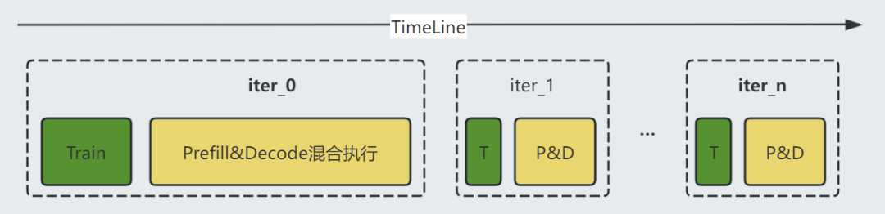
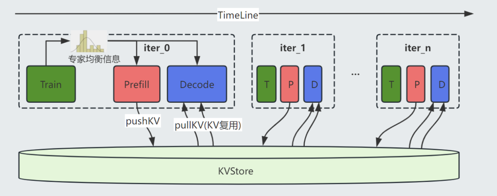
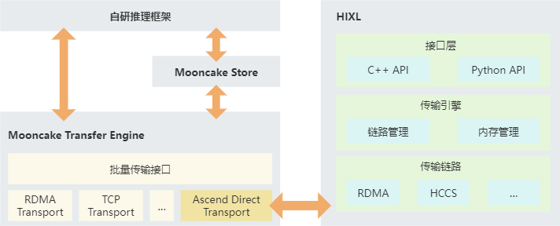
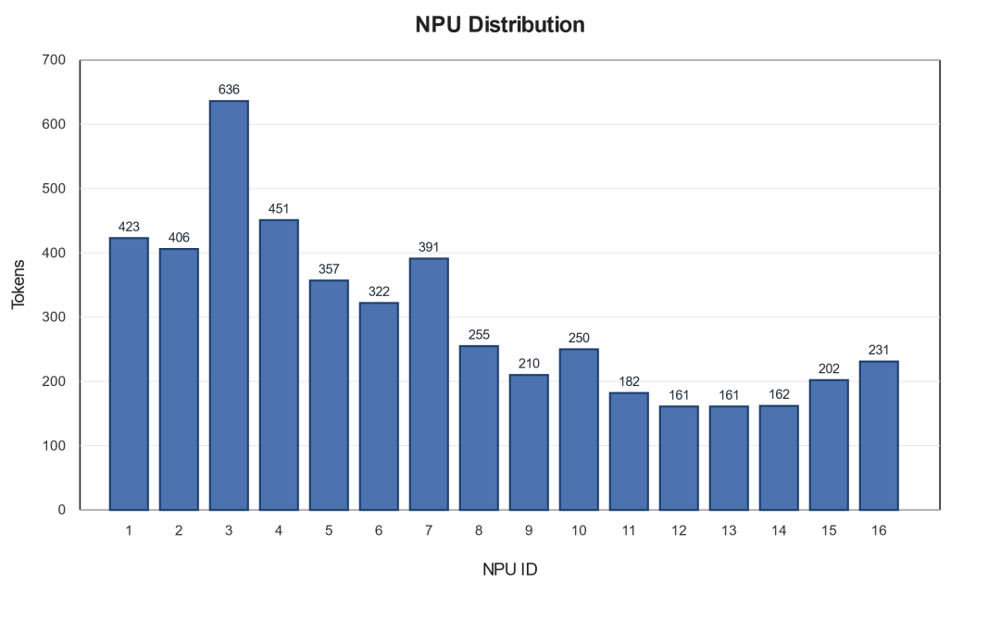
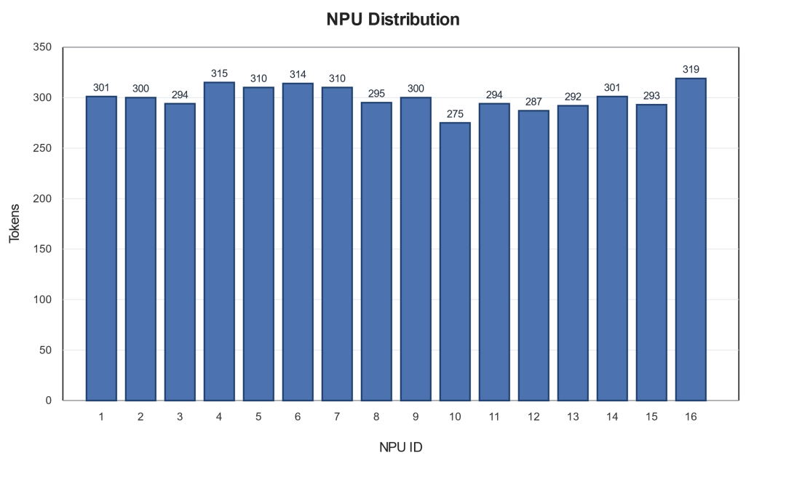

# 基于昇腾集群的词元星火RL优化实践

## 1. 背景：强化学习训练对大规模推理系统提出更高要求

随着大模型能力不断提升，强化学习训练已经成为模型从“会生成”走向“更会推理、更会对齐、更会完成复杂任务”的关键环节。相比普通预训练或监督微调，强化学习训练不仅涉及模型训练本身，还包含大规模采样、推理生成、奖励评估、策略更新等完整闭环，对算力集群的吞吐、稳定性和调度效率都提出了更高要求。

自研星火大模型采用MoE稀疏架构，并基于昇腾910系列算力组建万卡级训练集群。在面向大模型强化学习训练的过程中，CANN与词元星火团队围绕 MoE 专家负载均衡、RL采样阶段 Prefill/Decode 效率、Decoder动态调度等关键问题进行了系统性优化，使昇腾集群能够更高效地支撑大规模MoE模型的强化学习训练。

本文围绕这些工程实践展开，介绍词元星火团队在星火大模型于昇腾平台上优化强化学习训练过程的主要方案：先给出优化前后的整体流程对比，再依次介绍MoE专家负载均衡、P/D 两阶段采样、Decode 动态调度以及Beam Search并行优化等关键方案。

## 2. 总体方案：从混合执行到分阶段解耦

从整体流程看，优化前的 RL 采样流程中，训练阶段与推理采样阶段按迭代串行推进，Prefill 与 Decode 混合在同一阶段中执行。虽然这种方式实现简单，但在万卡规模下，Prefill 批量计算、Decode 长序列生成、任务调度和资源切换相互交织，容易产生算力空泡和局部负载不均衡。

图 1 优化前：Train 与 Prefill/Decode 混合执行的迭代流程

优化后，整体流程被拆解得更加清晰：训练阶段统计MoE专家均衡信息，并用于后续推理采样阶段的专家部署；采样阶段将 Prefill 与 Decode解耦为两个阶段执行；Prefill 生成的 KV Cache 写入统一 KVStore，Decode阶段再从 KVStore 拉取并复用 KV Cache。同时，Decode 请求可以根据负载动态分发到可用的模型组，从而减少长尾等待和局部热点。

图 2 优化后：专家均衡信息、P/D 两阶段分离与统一 KVStore 协同工作

注：图 2 中的 KVStore 采用 MooncakeStore 实现。MooncakeStore 是面向大模型推理场景的分布式 KV Cache 存储组件，负责承接 Prefill 阶段产生的 KV Cache，并为 Decode 阶段提供高效的拉取与复用能力。在昇腾 NPU 场景下，MooncakeStore 底层通过 Ascend Direct Transport 后端对接 HIXL（Huawei Xfer Library）。HIXL 是面向昇腾集群的单边通信库，提供简单、可靠、高效的点对点数据传输通道。总体而言，MooncakeStore 负责面向上层推理流程提供 KV Cache 存取能力，HIXL 负责在 NPU 集群中提供高效数据传输通道。

图 3 MooncakeStore 与 HIXL 的集成关系

## 3. MoE 专家负载均衡策略

### 3.1 MoE 稀疏激活带来的专家负载差异

MoE，即 Mixture of Experts，混合专家模型，是当前大模型扩展参数规模的重要架构之一。它的核心思想是将模型中的部分前馈网络替换为多个“专家”子网络，并通过门控网络或路由器，根据输入token的特征动态选择少量专家参与计算。

这种设计带来了一个重要优势：模型可以拥有非常大的总参数量，但每次推理只激活其中一小部分专家。也就是说，MoE 能够在扩大模型容量的同时，避免每个 token 都计算全部参数，从而兼顾模型效果和计算效率。

不过，MoE 的稀疏激活机制也带来了新的工程挑战：不同专家被调用的频率并不相同。在实际强化学习采样和推理过程中，路由器会根据输入内容动态选择专家。一些专家可能在特定任务、语义模式或数据分布下被更频繁地调用，而另一些专家调用频率较低。

如果只是简单地把专家平均部署到多张NPU上，例如每张卡放相同数量的专家，就可能出现“专家数量均衡，但专家计算负载不均衡”的问题。这不是简单把几个热点专家打散就能解决的，真正要解决的是整个集群推理过程中，不同NPU上承载的专家计算总负载不均衡。

图 4 不同设备（专家）计算不均衡

例子：256 个专家部署到 16 张 NPU

假设一个 MoE 模型有 256 个专家，部署在16张NPU上，每张NPU放 16个专家。如果只按专家编号平均切分，看起来每张卡都有16个专家，数量完全均衡。但如果某几张 NPU 上的16个专家总路由概率明显更高，这些 NPU 就会承担更多计算；另一些 NPU 上专家整体调用概率偏低，则会处于相对空闲状态。最终表现为局部热点、通信等待增加和整体吞吐下降。

### 3.2 基于专家负载画像的多 NPU 均衡部署

在明确专家负载差异之后，优化重点转向专家在多 NPU 上的部署方式。针对 MoE 专家计算不均衡问题，词元星火团队与 CANN 在昇腾平台上采用了基于专家负载画像的均衡部署策略。核心思路是：在训练过程中统计专家利用率，再在推理采样阶段根据专家负载重新分配专家，使每张 NPU 上专家的预期计算负载尽量接近。

#### 3.2.1 可以统计的专家负载信息

每个专家的token分配量可以作为专家负载的画像。模型加载到多 NPU 集群时，根据专家的预期调用负载进行组合，使每张 NPU 上多个专家的总负载尽量均衡。

图 5 不同设备（专家）计算均衡

仍以前面的例子说明：256个专家部署到16张NPU上，每张卡仍然放16个专家。但优化目标不再是简单满足“每张卡16个专家”，而是让每张卡上16个专家的路由概率之和尽可能接近。例如 NPU 0 上 16 个专家的总路由概率约为 3.1%，NPU 1 约为 3.0%，NPU 2 约为 3.2%，其他 NPU 也保持在接近水平。这样即使单个专家之间冷热不同，放到 NPU 维度后，各卡承载的专家计算总量也更加接近。

这种策略的关键不只是处理“热门专家”，而是从全局视角对所有专家进行负载编排：高负载专家、低负载专家、中等负载专家都参与组合，使每张 NPU 上的预期专家计算压力尽量拉平。优化后，集群中的单卡热点显著减少，专家计算等待和通信拥塞得到缓解，MoE 模型在强化学习采样阶段的吞吐和稳定性也随之提升。

## 4. P/D 两阶段采样：减少混合调度带来的算力空泡

### 4.1 Prefill 与 Decode 混合执行的问题

强化学习训练中的采样阶段通常包含两个核心推理过程：Prefill 和 Decode。Prefill 阶段主要处理输入 prompt，完成大批量上下文计算，并生成 KV Cache；Decode 阶段则是在已有 KV Cache 的基础上逐 token 生成输出。Prefill 计算密集，适合较大 batch 并行处理；Decode 迭代次数多、序列长度不确定，请求之间差异大，容易产生长尾。

在传统方案中，Prefill 和 Decode 往往混合在同一批设备上执行。但是由于 Prefill 和 Decode 的计算不均衡，导致在 DP+EP 并行模式下大部分情况下是 Decode 等待 Prefill。结果就是，虽然看起来 Prefill 和 Decode 在同一批卡上混跑可以互相填空，但实际调度过程中可能产生大量算力“空气泡”。在大规模的 RL 训练中，这类不均衡会被进一步放大。

### 4.2 P/D 共卡但分阶段运行的优化方案

因此，P/D 优化的关键不是继续增加混合调度的复杂度，而是把两个阶段拆开，使每个阶段采用更匹配自身特征的执行策略。针对上述问题，团队与 CANN 在昇腾平台上采用了 P/D 共卡但分阶段运行的采样方案。“共卡”是指Prefill 和 Decode 仍然使用同一批 NPU 资源；“两阶段分离”是指在执行流程上将 Prefill 和 Decode 解耦，不再让两类任务混合抢占同一设备，而是分阶段组织计算。

在 Prefill 阶段，系统集中处理大批量 prompt，充分发挥批量计算优势，并将生成的 KV Cache 写入统一KVStore。随后进入 Decode 阶段，Decoder 从 KVStore 中拉取对应请求的 KV Cache，继续完成后续生成。这种方式兼顾了资源复用和调度简化：Prefill 阶段更容易形成大 batch，Decode 阶段也不再被 Prefill 任务频繁打断，可以围绕长序列生成特点进行独立调度。

更重要的是，两阶段分离降低了 PD 混合执行时复杂调度造成的算力空泡。在万卡规模下，调度越复杂，局部不均衡越容易放大；将 Prefill 和 Decode 分阶段执行，可以让系统在每个阶段采用更适合该阶段的批处理和调度策略，从而提高整体设备利用率。

## 5. Decode 动态调度：从静态绑定到全局负载分发

在强化学习采样中，Decode 阶段通常是更容易出现长尾和负载不均衡的部分。原因很直接：不同请求的输出长度不同。如果请求被静态绑定到某一模型推理组上，那么这个请求从开始到结束都只能在该组内处理。这样会带来一个问题：有的模型推理组处理的请求很快结束，设备空闲；有的模型推理组遇到长输出请求，被长尾拖住。

例子：2048 条请求与 32 个模型推理组

假设一次采样有 2048 条请求，系统将其分配给 32 个模型推理组，每组处理 64 条请求。在优化前，每条请求只会在自己所属的那一组中完成 Decode，不会流转到其他组。如果某一组里的请求普遍较长，这组就会长时间忙碌；而另一组请求较短，可能较早完成后进入空闲。

优化后，Decode 阶段可以进行动态数据分发。Prefill 阶段完成后，KV Cache 已经进入统一 KVStore，Decode 请求不再固定绑定到原来的模型组，而是可以根据当前负载动态分发到任意可用的模型组。哪个模型组空闲，哪个就可以继续领取任务。这样可以有效缓解长短输出相互等待的问题，减少局部热点，提高整体吞吐。

## 6. Beam Search 场景优化：基于 KV 复用提升分支并行度

在部分强化学习采样或推理任务中，系统可能会使用 Beam Search 生成多个候选路径。Beam Search 的基本思想是：在生成过程中保留多个得分较高的候选序列，并继续向后扩展，最终选择质量更高的输出。

Beam Search 能提升生成质量，但也会放大Decode阶段的计算压力。因为同一个输入可能会扩展出多个分支，如果这些分支仍然被绑定在单个模型组或少量设备上，就容易出现并行度不足的问题。在优化前，Beam Search 的多个分支可能集中在局部执行，导致单个模型组Decode压力过高、分支并行展开不足、长分支拖慢整体完成时间。

引入统一KVStore和Decode动态调度后，Beam Search的多个分支可以复用同一份Prefill产生的KV Cache，并被分发到多个模型组上并行展开。这样既避免了重复Prefill计算，又提升了Decode阶段的并行能力。

## 7. 整体收益与工程价值

通过上述优化，词元星火大模型在昇腾平台上的强化学习训练取得了可量化的性能提升。由于 RL 训练中采样阶段占据较高时间比例，MoE 专家负载均衡、P/D 两阶段采样、KV Cache 复用以及 Decode 动态调度带来的采样性能提升，会进一步传导到端到端训练流程。在大规模的强化学习场景中，推理加速 30%，整体强化学习端到端训练效率提升约16%。多项优化共同作用，使采样阶段吞吐、稳定性和资源利用率得到提升。

从落地情况看，该方案已经在词元星火万卡规模集群上稳定运行，具备规模化推广和常态化使用条件。这说明在大规模 MoE 强化学习训练中，模型结构创新和系统工程优化需要协同演进，只有把算法特性与硬件特性和集群调度机制结合起来，才能持续释放大模型后训练场景下的工程效率。

HIXL仓：

https://gitcode.com/cann/hixl

Mooncake仓：

https://github.com/kvcache-ai/Mooncake
