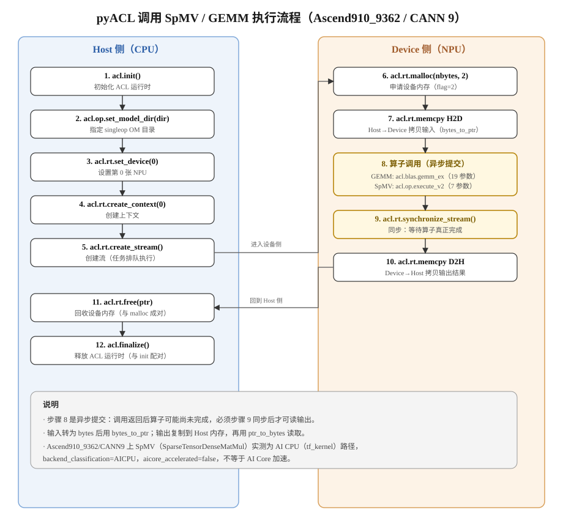

# ACL Python 算子库调用

使用 pyACL 调用 GEMM 和 COO SpMV。先用 ATC 生成单算子 OM，注册目录后执行算子，最后与 NumPy 结果比较。

## 开始前

了解 Python、NumPy、矩阵乘和 COO 稀疏矩阵，建议先学习第 04 章的设备内存与 Stream 概念。

## 学习目标

- 准备单算子 OM 和输入数据。
- 执行 GEMM、SpMV，使用 Event 计时并释放资源。
- 检查误差，比较两种算子的执行时间。

## 学习顺序

按下表打开 Notebook。每个实验已包含相关原理、编译运行和结果分析；做完实验后再完成章节练习。

| 顺序 | Notebook | 内容 |
|---|---|---|
| 1 | [ACL Python 算子调用：GEMM](05_gemm.ipynb) | 准备环境、理解原理、运行并分析结果 |
| 2 | [ACL Python 算子调用：SpMV](05_spmv.ipynb) | 准备环境、理解原理、运行并分析结果 |
| 3 | [第 05 章练习](05_practice.ipynb) | 检查理解、完成编程与分析题 |

## 实验环境

课程使用 CANNLab Atlas A3（SoC `Ascend910_9362`）、CANN 9.0，镜像为 `cann_9.0.0-py3.11-A3-arm-20260829`，Notebook 内核为 `Python 3.11.4`。平台使用方法见[CANNLab 环境体验指南](../../../../docs/CANNLab_env_experience_guide.md)。

GEMM 使用 `acl.blas.gemm_ex`，SpMV 使用 `acl.op.execute_v2`。本实验 SpMV 运行于 AI CPU/tf_kernel；GEMM 通过设备端 BLAS 接口执行。

## Python 算子调用过程

## 两个算子

| 算子 | Python API | 输入格式 | 执行位置 |
|---|---|---|---|
| GEMM | `acl.blas.gemm_ex` | A[M,K]、B[K,N]、C[M,N] | 设备端，具体 Kernel 类别需查看运行记录 |
| SpMV | `acl.op.execute_v2` | COO 坐标、数值、矩阵形状和向量 x | 本实验使用 AI CPU/tf_kernel |
