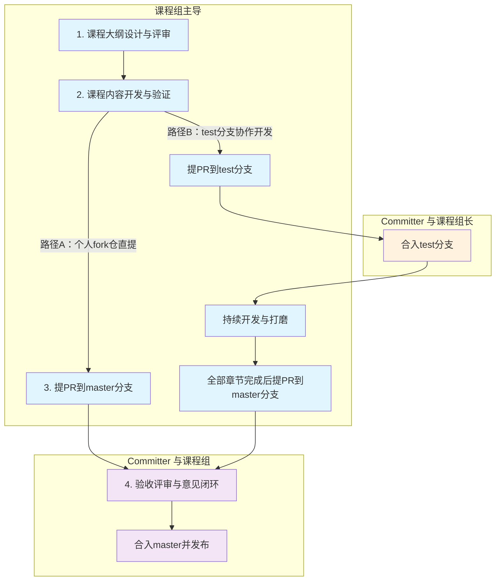

# 新课程上库与流程上线验收标准

适用范围：所有新增或重构后准备合入 cann-learning-hub 的课程。

用途：PR 作者自检、Committer 验收、课程上库准入判断。

**按角色查找内容：**

| 角色 | 阅读顺序 |
| --- | --- |
| 课程开发者 | 第 2 节定大纲 → 第 3 节写内容 → 第 5 节逐项自检 → 第 1 节走流程 |
| Committer | 第 5 节逐项验收 → 第 1 节阶段表确认责任 → 第 4 节确认验证环境 |
| 课程组长 | 第 2 节大纲分层评审 → 第 1.1 节路径B 的 `test` 合入 |

---

## 1. 上线流程

课程从大纲到合入 `master` 分四个阶段：课程组产出内容，Committer 在关键节点把关。

| 阶段 | 课程组 | Committer | 本阶段要达成的状态 |
| --- | --- | --- | --- |
| 1. 大纲设计与评审 | 设计课程大纲，完成内部分层评审 | — | 明确课程主题、章节规划、学习路径、目标对象，以及初中高级能力递进关系和考核方式。 |
| 2. 内容开发与验证 | 在个人 fork 仓开发 README、章节 notebook、answer、images、src，并在开发分支上运行验证 | — | 课程内容按大纲完成，在开发分支上运行无误。 |
| 3. 提交 PR | 完成 AI 低错检查（拼写、格式、语法、链接）、第 5 节 Checklist 自检、全课程运行验证，并同步更新仓库根 README 的课程简介、学习人群、硬件产品、环境配置、章节目录 | — | 验证结论与自检结论写进 PR 描述。 |
| 4. 验收与合入 | 逐条闭环评审意见 | 在 PR 分支运行验证，并在线体验后给出评论 | notebook 可运行、结果合理，评审意见全部闭环后合入 `master` 发布。 |

### 1.1 选哪条提交路径

| 路径 | 适用情况 | 集成位置 | 审核节点 |
| --- | --- | --- | --- |
| A：个人 fork 仓直提 | 个人开发者、课程内容量偏小 | 个人 fork 仓的开发分支，过程私有，不影响公共仓库 | 只在 `master` PR 审核一次 |
| B：`test` 分支协作开发 | 课程内容量较大、需要多人协作 | 主仓 `test` 分支，过程公开，各团队产出集中管理 | 合入 `test` 时预审一次，合入 `master` 时复审 |

两条路径的终点相同：全部开发完成后统一提交至 `master`，保证 `master` 上均为验证通过、可执行的课程。

路径B 在上述四个阶段之外另有三个动作：

1. **合入 `test`**：课程组长与 Committer 按 `master` 准入标准审核（知识正确性、章节逻辑、教学深度、低错、运行验证）后合入，保持“准发布”状态；合入不得更改非本课程文件。
2. **持续打磨**：在个人 fork 仓的 `test` 分支继续开发，新增章节、补充案例、优化教学逻辑，按需验证；多人渐进开发期间 `test` 分支不承诺整体可运行。
3. **完成后合入 `master`**：选择性提取课程文件、排除无关变更，操作见[附录二](#附录二test--master-选择性合并操作指引)。

### 1.2 分支分工

| 分支 | 面向 | 存放内容 | 状态承诺 |
| --- | --- | --- | --- |
| `master` | 外部开发者 | 开发完成、环境验证通过的课程 | 对外体验内容一律以 `master` 为准。进入 `master` 的课程必须已在 PR 分支完成运行验证，且 Committer 验收意见全部闭环。 |
| `test` | 课程开发团队 | 开发中与验证中的课程 | 不承诺任意时刻整体可运行，不对外提供在线体验。 |

> `test` 分支上的课程在全部章节完成并合入 `master` 前，不对外提供体验入口。

### 1.3 流程图



步骤要求以上述表格为准，图中只表示流转与责任方。

---

## 2. 课程大纲与能力分层设计规范

课程大纲以学习者能力成长为主线，需说明以下问题：

- **目标人群**：课程面向谁？学习起点是什么？
- **教学目标**：学完后能做什么？达到什么能力水平？
- **设计思路**：如何由浅入深组织章节、实践任务和阶段性成果？
- **趣味性**：如何通过案例、互动、挑战任务等方式提升学习者的参与感和完成成就感？

课程大纲应体现明确的能力分层递进关系（如初级、中级、高级），每个层级需说明覆盖章节、核心能力、典型任务及考核方式。能力分层设计为后续不同层级的能力认证考试提供依据，确保课程内容、实践任务与认证考核目标一致。

以下以 Ascend C 算子开发系列课程为例，展示能力分层设计参考（章节编号不严格代表难度顺序，以能力目标为准）：

| 阶段 | 章节范围 | 能力目标 | 考核方式 |
| --- | --- | --- | --- |
| 初级 | 第 1-2 章 | 理解基础概念，掌握核函数开发、调用方式及简单矢量算子编程方法。 | 选择题检验知识点掌握情况。 |
| 中级 | 第 3-4、7 章 | 掌握工程化算子开发、泛化 Tiling、API 调用算子、矩阵乘法高阶 API 开发及精度调试方法。 | 复杂矢量算子编程实践。 |
| 高级 | 第 5-6、8 章及以后 | 掌握融合算子开发、性能调优方法及开源仓贡献流程。 | 融合算子编程实践。 |

---

## 3. 课程内容验收标准

### 3.1 目录结构规范

每个课程按“课程 → 章节 → 小节”三级组织，目录可定位、可维护。

```text
tutorials/
└── course_name/
    ├── README.md
    ├── slides/
    │   ├── 01_topic_name.pptx
    │   └── 02_topic_name.pptx
    ├── 01_chapter_name/
    │   ├── 01.01_chapter_intro.ipynb
    │   ├── 01.02_section_name.ipynb
    │   ├── 01.03_chapter_test.ipynb
    │   ├── answer/
    │   ├── images/
    │   └── src/
    └── 02_chapter_name/
        ├── 02.01_chapter_intro.ipynb
        ├── 02.02_section_name.ipynb
        ├── 02.03_chapter_test.ipynb
        ├── answer/
        ├── images/
        └── src/
```

> **适用目录**：官方课程位于 `tutorials/`，社区贡献课程位于 `contrib/tutorials/`，两者目录结构与命名规范一致。

**命名规范**

- 目录名、文件名使用英文、数字、下划线，必要时使用点号，不包含中文。
- 章节目录：`0n_abc` 格式，如 `01_introduction`。
- 小节 notebook：`0n.0m_abc.ipynb` 格式，如 `01.01_chapter_intro.ipynb`。
- 课件文件：放在 `slides/` 目录下，前置编号固定阅读顺序，格式为 `0n_topic_name.pptx`，如 `01_introduction.pptx`。

**目录内容**

- 每个课程根目录必须包含主 `README.md`。
- 每个章节目录包含多个 notebook 及 `answer/`、`images/`、`src/` 三个子目录。
- 课件（如有）统一放在课程根目录的 `slides/` 下；无课件的课程可省略该目录。

### 3.2 主 README.md 要求

主 README 为课程入口文档，必须包含以下五项：

| 项 | 内容 |
| --- | --- |
| ① 课程整体简介 | 课程内容与整体学习目标。 |
| ② 课程适用学习人群 | 前置知识要求（学习课程、知识储备等）。 |
| ③ 课程支持的硬件产品 | 全部验证通过的硬件型号，便于开发者确认适配性。 |
| ④ 已验证的在线体验环境 | 验证无报错的环境及配置要求，见第 4 节。 |
| ⑤ 课程章节目录 | 分章节表格，提供跳转链接。 |

③ 的参考写法：

```markdown
## 软硬件配套说明

| 项目 | 要求 |
| --- | --- |
| 支持硬件 | Atlas A2 训练/推理系列产品、Atlas A3 训练/推理系列产品 |
| CANN 版本 | 9.0.0 及以上 |
| Python | 3.11 |
```

> 如支持在 cann-learning-hub 在线体验 notebook 中执行，在线体验链接由 Committer 统一配置，课程开发时 `Link` 列填写 `-` 即可；否则给出课程跳转链接即可。

### 3.3 单个章节结构规范

每个章节目录包含多个 notebook，结构要求如下：

**第一小节：章节概述**（如 `01.01_chapter_intro.ipynb`）

- 前置要求：所需能力、前置教程/章节、环境要求。
- 章节目标：学完后能做到什么。
- 章节内容：各小节简介及跳转链接。

**最后一小节：章节实践**（如 `01.03_chapter_test.ipynb`）

- 包含客观题（选择/填空）检验知识点掌握情况，以及 3 道编程实践题（简单、中等、困难各一道）检验综合应用能力。
  - 简单：单知识点，补全或改写给定代码。
  - 中等：多知识点组合，需自行设计切分或 Tiling。
  - 困难：融合算子、性能优化、精度调试中的任一项。

**中间小节**（按实际内容拆分）

- 必须包含：小节概述 + 教程内容 + 课后练习/实践。
- 纯知识点小节出选择题/填空题，含代码实操小节出代码实践题。
- 所有练习与实践均须提供答案或参考实现。

### 3.4 Notebook 内容规范

**① 风格统一**：同一课程各 notebook 风格一致，图片、表格居左对齐，表格使用 HTML `<table>` 且 `text-align:left`；标题层级只用 2–4 级。

**② 教程内容**

- **逻辑清晰**：按“前置概念 → 用法 → 示例”推进，每个新概念在其首次出现的 cell 之前或同一 cell 内完成定义。
- **概念解释**：首次出现的新概念、新工具、新命令、新参数须解释清楚，不得默认学习者已知。
- **图片辅助**：每个章节目录的 `images/` 至少 1 张图，覆盖架构、流程、运行结果之一；架构、流程、数据流、模型结构等复杂内容优先用图说明。
- **可执行示例**：正文使用完整可运行的示例代码，工程的创建、依赖安装、代码开发、脚本运行等均在 notebook 的 code cell 中执行，学习者无需手动切换文件夹。
- **源码说明**：每个关键源码文件须说明作用。源码较多无法全部展示时，存入 `src/` 目录，并在 notebook 中用 `cat`、`tree`、`ls` 等命令展示关键结构和内容。

**③ 课后实践**

- 须有独立输入、任务说明和答案。
- 实践题操作步骤均在 notebook 的 code cell 中执行。
- 工程存于 `src/` 对应小节目录，待填写文件通过 `%%writefile` 命令提供写入操作。
- 答案通过 `cat` 命令展示。

### 3.5 answer / images / src 目录说明

| 目录 | 用途 |
| --- | --- |
| `images/` | 存放章节配图 |
| `answer/` | 存放课后练习、实践题的答案 |
| `src/` | 存放不便完整写入 notebook 的工程源码 |

三个目录下可按 `0n.0m_abc` 格式新建子目录，以对应具体小节。

---

## 4. 在线体验环境验证要求

课程必须在目标硬件对应的在线体验环境完成验证，确保学习者可直接打开 notebook 完成操作。课程开发与验证可参考 [基于 CANNLab 环境开发与提交课程指南](./CANNLab_course_development_guide.md)。

**支持的在线体验环境**

- gitcode 在线体验 notebook
- CANNLab 环境
  - 云开发环境
  - 950 尝鲜体验环境
  - CPU 仿真环境

**验证要求**

- 所有课程须在至少一个 CANNLab 环境开箱即用、运行无报错。验证环境须为**外部开发者可创建的环境**，不得使用内部用户环境或本地环境。
- 验证在 PR 阶段于 PR 分支上完成（路径A 在 `master` PR 分支，路径B 在 `test` PR 与 `master` PR 分支），Committer 确认通过后方可合入 `master`。
- 算子课程及模型参数量 <0.5B 的课程，还须能在 cann-learning-hub notebook 直接运行；参数量以 README 声明的模型 config 或权重文件大小为准。
- **【硬性】CANNLab 环境须在主 README 中写明 NPU 镜像模板名称和 Python 内核版本**，确保开发者可复现。

④ 的参考写法：

```markdown
## 在线体验环境

本教程支持以下在线体验环境：

| 体验环境 | 镜像模板 / 版本 | Python 内核 | 说明 |
| --- | --- | --- | --- |
| cann-learning-hub 在线体验 notebook | cann_9.0.0_py3.11-A2-arm | Python 3.11.4 | 各 Notebook 表格中的"在线体验"链接可直接打开运行 |
| CANNLab 云开发环境 | cann_9.0.0_py3.11-A2-arm | Python 3.11.4 | 参考 [CANNLab 环境体验指南](https://gitcode.com/cann/cann-learning-hub/blob/master/docs/CANNLab_env_experience_guide.md)创建 CANNLab 环境运行 notebook |

> **注意：** 表中 Python 内核版本为创建环境后执行 `which python` 的实测值；同一镜像模板应保持一致，如实测值与表中不一致，请以实测为准并在主 README 中注明。
```

> 在本地环境离线体验需自行安装配套的 CANN 软件，请参考 [CANN 安装指南](https://www.hiascend.com/document/detail/zh/CANNCommunityEdition/600alpha003/softwareinstall/instg/atlasdeploy_03_0001.html)，选择对应 CANN 版本文档。

## 5. PR 准入 Checklist

> 课程组发起 PR 前逐项自检（路径A 在提 `master` PR 前、路径B 在提 `test` PR 前），全部通过后方可发起 PR。可将本清单提供给 AI 辅助预检，快速定位问题。

### A. 结构与命名（1–5）

| 序号 | 验收项 | 准入要求 | 结果 |
| --- | --- | --- | --- |
| 1 | 命名规范 | 课程目录、章节目录、文件名均为英文、数字、下划线或点号，不包含中文。 | □ 通过  □ 不通过 |
| 2 | 章节命名 | 章节目录命名符合 `0n_abc` 格式。 | □ 通过  □ 不通过 |
| 3 | 小节命名 | 小节 notebook 命名符合 `0n.0m_abc.ipynb` 格式。 | □ 通过  □ 不通过 |
| 4 | 主README | 按 §3.2 逐项核对 ①–⑤，且与课程实际内容保持同步。 | □ 通过  □ 不通过 |
| 5 | answer/images/src目录 | 每个章节目录包含 `answer`、`images`、`src` 三个子目录。 | □ 通过  □ 不通过 |

### B. 章节与内容（6–13）

| 序号 | 验收项 | 准入要求 | 结果 |
| --- | --- | --- | --- |
| 6 | 章节概述 | 每个章节第一小节为章节概述，包含前置要求、章节目标、章节内容及小节跳转链接。 | □ 通过  □ 不通过 |
| 7 | 章节实践 | 每个章节最后一小节为章节实践，包含客观题（选择/填空）及 3 道编程实践题（简单、中等、困难各一道）；难度判定见 §3.3。 | □ 通过  □ 不通过 |
| 8 | 中间小节 | 每个中间小节包含小节概述、教程内容、课后练习或课后实践。 | □ 通过  □ 不通过 |
| 9 | 答案提供 | 所有课后练习、课后实践、章节实践均有答案或参考实现，并放入 `answer` 目录。 | □ 通过  □ 不通过 |
| 10 | 图片引用 | 图片位于 `images` 目录并使用相对路径引用；每个章节目录至少 1 张。 | □ 通过  □ 不通过 |
| 11 | 风格统一 | 各 notebook 风格一致，图片和表格居左对齐，表格使用 HTML `<table>` 且 `text-align:left`；标题层级只用 2–4 级。 | □ 通过  □ 不通过 |
| 12 | 代码执行 | 除纯理论内容外，notebook 中所有代码均可从上到下执行并得到正确结果。 | □ 通过  □ 不通过 |
| 13 | 代码解耦 | 教程正文代码与实践题代码相互解耦。 | □ 通过  □ 不通过 |

### C. 呈现与操作（14–16）

| 序号 | 验收项 | 准入要求 | 结果 |
| --- | --- | --- | --- |
| 14 | 源码查看 | 源码较多放入 `src` 时，notebook 中提供 `cat`、`tree`、`ls` 等命令查看、说明关键源码结构和内容。 | □ 通过  □ 不通过  □ 不适用 |
| 15 | 完整操作 | 学习者无需手动到其他目录查找或修改代码即可完成教程。 | □ 通过  □ 不通过 |
| 16 | 行文逻辑 | 行文通顺，按“前置概念 → 用法 → 示例”推进，新概念在其首次出现的 cell 之前或同一 cell 内完成解释。 | □ 通过  □ 不通过 |

### D. 环境、课件与提交（17–21）

| 序号 | 验收项 | 准入要求 | 结果 |
| --- | --- | --- | --- |
| 17 | 运行验证 | 已在外部开发者可创建的 CANNLab 环境完成实际运行验证（不得使用内部用户环境或本地环境），运行无报错；PR 描述中附验证结论（含硬件型号、运行环境、在线体验环境和验证结果）。路径A 在提 `master` PR 前完成，路径B 在合入 `test` 时按同标准执行、`master` PR 阶段复审。 | □ 通过  □ 不通过 |
| 18 | CANNLab环境配置 | 主README中写明 CANNLab 环境的 NPU 镜像模板名称和 Python 内核版本，并附 CANNLab 环境体验指南链接。 | □ 通过  □ 不通过  □ 不适用 |
| 19 | gitcode notebook | 算子课程和模型参数量 <0.5B 的课程，须在 cann-learning-hub notebook 可直接运行；参数量以 README 声明的模型 config 或权重文件大小为准。 | □ 通过  □ 不通过  □ 不适用 |
| 20 | 清理输出 | 提交 PR 前已删除所有 code cell 的输出内容。 | □ 通过  □ 不通过 |
| 21 | 课件规范 | 若提供课件：页面构成齐全（封面页、修订记录页、目录页、章节标题页、内容页、结束页），见[附录一第 1 节](#1-必须包含的页面)；版本号见[第 3 节](#3-版本号规则)；修订记录页写法见[第 2.2 节](#22-修订记录页)；无课件选「不适用」。 | □ 通过  □ 不通过  □ 不适用 |

**自检说明**：以上所有项须全部通过（含条件项结论明确）后，方可从课程组侧发起 PR（路径A 提至 `master`、路径B 提至 `test` 分支）。

---

## 附录一：课程 PPT 课件规范

课程 PPT 课件用于讲师引导式教学，须基于 CANN 社区统一模板：[cann_learning_hub_ppt_template.pptx](./slides/cann_learning_hub_ppt_template.pptx)。本节先说明课件必须包含哪些页面，再逐页给出规则。

### 1. 必须包含的页面

课件由下列页面按固定顺序构成，共六类：

| 页序 | 页面 | 必须性 | 作用 |
| --- | --- | --- | --- |
| 第 1 页 | 封面页 | 必须 | 课程名称、作者、日期 |
| 第 2 页 | 修订记录页 | 必须 | 记录历次重大更改 |
| 第 3 页 | 目录页 | 必须 | 列出课程全部 Part |
| 正文 | 章节标题页 | 每个 Part 一张 | 分隔各部分 |
| 正文 | 内容页 | 含习题页、拓展学习页各一张 | 正文讲解、参考资料、习题入口 |
| 末页 | 结束页 | 必须 | 致谢与社区信息 |

- 各页保留页脚 `https://gitcode.com/cann` 和 CANN logo；当被实质内容遮挡（部分或全部）时可酌情删除，以页面美观为准。
- 修订记录页中的「修订页码」按本页序计算，封面为第 1 页。

### 2. 逐页规则

#### 2.1 封面页

- 位置：第 1 页。
- 内容：课程名称（主标题）、作者、日期；一句话副标题可选。
- 版式：主标题位于页面上部、约 40pt 加粗；作者与日期同一行、约 16pt。

#### 2.2 修订记录页

- 位置：第 2 页；标题文字「修订记录」，约 24pt 加粗、左对齐。
- 表格：5 列，顺序固定为 版本号、修订日期、修订人、修订页码、修订内容摘要。
- 记录范围：只记重大更改——新增或删除章节、内容重构或讲解顺序调整、教学目标与实践题变更、示例代码或运行环境变更、支持硬件变化。
- 不计入：错别字、标点、排版微调、单页配图替换、链接修正。

各列写法：

| 列 | 写法 |
| --- | --- |
| 版本号 | 按第 3 节规则，如 `V2.0`、`V2.1` |
| 修订日期 | `YYYY/MM/DD`，如 `2026/11/26` |
| 修订人 | 真实姓名，多名修订人用顿号分隔 |
| 修订页码 | 单页 `P7`，区间 `P5-P10`，多段用顿号分隔如 `P5-P10、P41-P43`；全文改动写「全部」 |
| 修订内容摘要 | 写清改了什么、影响哪些内容，不少于 20 字；不用「优化若干内容」「细节调整」这类笼统说法 |

#### 2.3 目录页

- 位置：第 3 页；标题「目录」。
- 内容：列出课程全部 Part（`Part n 名称`），与正文各章节标题页一一对应。

#### 2.4 章节标题页

- 每个 Part 的正文之前一张。
- 标题与该 Part 名称一致。

#### 2.5 内容页

- 位于固定页之间，可按需扩展；每页一个主题，标题位于页面上部。
- **必须包含以下两页参考资料（缺一不可）**：
  - **习题页**：承载 3 道 CannJudge 题库习题，逐题写明题目描述，并给出「进入题库」与完整链接（`https://cannjudge.cn/...`）。
  - **拓展学习页**：承载课程学完后可继续深入了解的资源，列出相关 SIG 组织或代码仓库，逐项给出说明与完整链接（`https://gitcode.com/cann/...`）。
- 其它内容页承载正文讲解等；凡涉及外部链接（题库、仓库等）均须给出完整 URL。

#### 2.6 结束页

- 位置：最后一页。
- 内容：致谢语（如 `Thank you.`）、社区信息（社区与公众号获取方式）。

### 3. 版本号规则

格式为 `V<大版本号>.<小版本号>`。

- 大版本号与课程支持的硬件版本一致，取所支持硬件中最小的数字：A2 → 2，A3 → 3，A5 → 5。如课程同时支持 A2 与 A3 时，大版本号为 2。
- 小版本号从 `.0` 起，首次上架为 `V<大版本>.0`，此后每次重大更改递增 `0.1`。
- 同一课程的多份课件使用同一版本号。

### 4. 体积与模板

- 必须使用 CANN 社区统一模板：[cann_learning_hub_ppt_template.pptx](./slides/cann_learning_hub_ppt_template.pptx)。
- 大图片和视频须压缩处理，单个 PPT 文件尽量控制在 5MB 以内。
- 课件使用 LFS 方式上传。

### 5. 主 README 列出课件

课程主 `README.md` 中使用表格列出并介绍 PPT 课件：

```markdown
## 课程内容

| 序号 | 主题 | 主要内容 | 课件 |
|---|---|---|---|
| 01 | 主题名称 | 主要内容概述 | [01_topic_name.pptx](./slides/01_topic_name.pptx) |
| 02 | 主题名称 | 主要内容概述 | [02_topic_name.pptx](./slides/02_topic_name.pptx) |
```

---

## 附录二：test → master 选择性合并操作指引

仅路径B 需要执行本附录操作。在全部章节完成、准备合入 `master` 时，需将 `test` 分支中的课程内容合并到 `master`，同时排除 `test` 分支上的无关变更（临时调试代码、测试 notebook、调试脚本等）。两分支可能存在较大差异，直接通过网页合并不现实，以下提供两种方式。

### 方式一：git checkout 命令（推荐）

使用 `git checkout test -- <文件路径>` 从 `test` 分支选择性检出指定文件或目录到当前工作区。

前提：本地已拉取最新代码、当前在 `master` 分支、工作区干净（`git status` 确认无未提交修改）。

```bash
# 1. 切到 master 并更新
git checkout master
git pull origin master

# 2. 从 test 检出课程目录（会覆盖本地同名文件/目录）
git checkout test -- tutorials/sample_course/

# 3. 确认只改动了课程相关文件
git status

# 4. 提交并推送
git add tutorials/sample_course/
git commit -m "feat: 从 test 分支合并 sample_course 课程内容"
git push origin master
```

只合并部分文件时，逐项指定路径：

```bash
git checkout test -- tutorials/sample_course/README.md
git checkout test -- tutorials/sample_course/01_introduction/
```

`master` 上该课程已有旧版本时可能出现冲突，手动编辑冲突文件后 `git add <冲突文件>` 再提交。合并前可用 `git diff test -- tutorials/sample_course/` 预先查看差异。

### 方式二：本地文件迁移（适合不熟悉 Git 命令的开发者）

1. 切到 `test` 分支，把课程目录复制到临时目录。
2. 切回 `master` 并 `git pull` 更新。
3. 把临时目录中的课程目录复制回 `tutorials/`，`git status` 确认变更范围后提交推送。

> Windows 环境没有 `cp -r`，用资源管理器复制目录，或改用 `robocopy tutorials\sample_course tutorials\sample_course /E`。

### 关键提醒

| 事项 | 说明 |
| --- | --- |
| ⚠️ 覆盖风险 | `git checkout test -- <文件>` 会**直接覆盖**工作区同名文件，操作前确认 `master` 分支上没有未提交的修改。 |
| 🔍 谨慎确认 | 合并前执行 `git diff test -- <文件路径>` 可预先查看变更差异。 |
| 💡 替代命令 | 若 `git checkout` 在较新版本 Git 中已弃用，可使用 `git restore --source=test -- <文件>` 替代。 |
